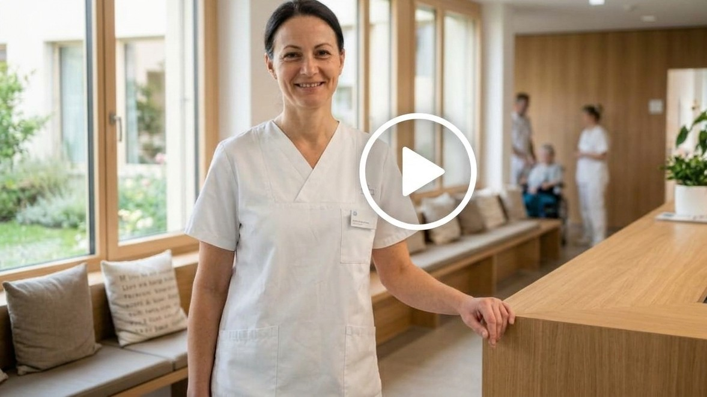

::: mini-nav
[⌂ Übersicht](index.qmd)
:::

::: hinweis-prototyp
Entwurf vom 27. November 2026, abgeleitet von der Seite für den stationären Eintritt. Bis zum Eintrittstag ist der Text gleich, danach folgt der ambulante Ablauf. Fachlich noch nicht freigegeben.
:::

[Danke für Ihr Vertrauen in die Klinik St. Anna. Sie kommen für einen Eingriff zu uns und gehen am gleichen Tag wieder nach Hause. Diese Seite führt Sie vom Tag der Anmeldung bis zur ersten Woche zu Hause. Jeder Abschnitt erklärt, was wir tun und was in Ihrer Hand liegt.]{.lede}

::: weiche
**Kommen Sie zu einem Herzkatheter?** Dann gilt für Sie einiges anders, vor allem wenn er ohne Narkose stattfindet. Lesen Sie bitte zuerst hier: [Ihr Herzkatheter, Schritt für Schritt →](herzkatheter.qmd)
:::

## So läuft Ihr Eingriff ab {#kurz}

Tippen Sie auf den Schritt, bei dem Sie gerade stehen. Was bei Ihnen schon erledigt ist, überspringen Sie.

::: kurzliste
1. [Nach der Anmeldung:](#heute) Gesundheitsfragebogen, Formulare aus dem Couvert, bei Bedarf ein Bericht Ihrer Hausärztin oder Ihres Hausarztes
2. [Bis zum Eintritt:](#wochen) Narkosegespräch, Abholung und erste Nacht zu Hause organisieren
3. [Am Vortag:](#vortag) Eintrittszeit per SMS, Zeiten für Essen und Trinken, packen
4. [Am Tag des Eingriffs:](#eintrittstag) Ankommen, warten, Eingriff, erholen, nach Hause
5. [Zu Hause:](#zuhause) die erste Nacht und die erste Woche
:::

```{=html}
<p class="werkzeuge">
<a class="werkzeug" href="#unterstuetzung">Wenn Sie Unterstützung brauchen</a>
<span class="werkzeug ph">Italiano · Français: foglio informativo</span>
</p>
```

::: kontaktzeile
**So erreichen Sie uns.** Jede Frage ist willkommen.


:::

::: {#kurz-weg .kurzweg}
**Ist Ihr Eingriff kurzfristig geplant?** Manchmal liegen zwischen Anmeldung und Eingriff nur wenige Tage. Die Reihenfolge bleibt dann gleich, die Schritte folgen nur dichter aufeinander. Sie haben nichts verpasst.
:::

:::::::::::::::::::::::: zeit
:::::: station
## Nach der Anmeldung: Fragebogen und Bestätigung {#heute}

[Wann]{.wann} Ab dem Tag, an dem Ihre Ärztin oder Ihr Arzt Sie bei uns anmeldet.

### Was wir tun

Sie haben von uns eine **E-Mail** mit dem Link zum Online-Gesundheitsfragebogen erhalten. Dazu kam eine SMS mit einem Sicherheitscode für den Fragebogen.

Per Post erhalten Sie später ein **Couvert** von uns. Darin sind die Anmeldebestätigung mit dem Datum Ihres Eingriffs und mehrere Formulare. Je nach Termin kommt das Couvert in einigen Tagen oder Wochen.

### Was in Ihrer Hand liegt

::: tun
- Sie füllen den **Gesundheitsfragebogen** innerhalb von [5 Tagen]{.ph} aus. Rechnen Sie mit 10 bis 60 Minuten. Ihre Antworten dienen dazu, das Narkosegespräch und medizinische Abklärungen zu planen. Falls Sie den Fragebogen schon ausgefüllt haben, ist dieser Punkt erledigt.
- Kommen Sie mit dem Fragebogen nicht weiter? Dann lassen Sie ihn offen. Wir rufen Sie nach etwa [5 Tagen]{.ph} an.
- Wenn später das Couvert per Post ankommt, lesen Sie zuerst das beiliegende **Faltblatt**. Es erklärt Ihnen alle Schritte und zu jedem Formular, was Sie damit tun. Die Formulare, die an uns zurückgehen, schicken Sie möglichst bald im beiliegenden Rücksendecouvert.
- Sind Sie über 70 Jahre alt, oder haben Sie eine Krankheit an Herz oder Kreislauf oder eine andere gesundheitliche Einschränkung? Dann gehen Sie bitte jetzt zu Ihrer **Hausärztin oder Ihrem Hausarzt** und lassen dort einen Gesundheitsbericht ausstellen. Bitten Sie die Praxis, den Bericht an zuweiserberichte@hirslanden.ch zu schicken.
:::
::::::

::::: station
## Bis zum Eintritt: Vorbereitung und Narkosegespräch {#wochen}

[Wann]{.wann} Zwischen Anmeldung und Eingriff. Das können mehrere Wochen sein oder wenige Tage.

### Was wir tun

Wir besprechen Ihre Narkose mit Ihnen, spätestens am Vortag am Telefon (siehe [Am Vortag](#vortag)). Je nach Eingriff und Gesundheitszustand **bieten wir Sie vorher zusätzlich in die Anästhesie-Sprechstunde auf**. Dieses Gespräch findet in der Klinik oder am Telefon statt. Für den Termin melden wir uns bei Ihnen. Im Gespräch mit der Anästhesieärztin oder dem Anästhesiearzt wird Ihre Narkose auf Sie abgestimmt. Sie können dort auch alles fragen, was Sie zur Narkose wissen möchten.

### Was in Ihrer Hand liegt

::: tun
- Sie organisieren, wer Sie nach dem Eingriff abholt und nach Hause begleitet. Nach einer Narkose dürfen Sie 24 Stunden nicht selbst fahren.
- Sie sorgen dafür, dass in der ersten Nacht jemand bei Ihnen zu Hause ist. [Anforderung der Anästhesie bestätigen: Begleitung auf dem Heimweg, Betreuung in der ersten Nacht.]{.ph}
- Haben Sie niemanden, der Sie abholt oder bei Ihnen bleibt? Dann lesen Sie den Abschnitt [Wenn Sie Unterstützung brauchen](#unterstuetzung) am Schluss dieser Seite.
- Nehmen Sie Blutverdünner oder Diabetesmedikamente? Dann sagt Ihnen die Anästhesie oder Ihre Ärztin oder Ihr Arzt, ob Sie diese vor dem Eingriff weglassen sollen und ab welchem Tag. Bis dahin nehmen Sie sie wie gewohnt.
- Alle anderen Medikamente nehmen Sie weiter wie gewohnt. Sind Änderungen nötig, sagt es Ihnen die Anästhesie oder Ihre Ärztin oder Ihr Arzt.
- Bei Fieber, Husten oder Erkältung vor dem Eingriff rufen Sie die Anästhesie an: +41 41 208 33 88. Das gilt auch kurz vor dem Eintritt und wenn es Ihnen insgesamt schlechter geht. Diese Information ist sehr wichtig für uns.
:::

::: hilft
### Was Sie vor dem Eingriff für sich tun können

Vier Dinge helfen Ihnen bei der Vorbereitung:

- Bewegen: Spazieren oder gehen Sie jeden Tag, so gut es Ihnen möglich ist. Dann kommen Sie nach dem Eingriff schneller wieder zu Kräften.
- Nicht rauchen: Jeder rauchfreie Tag vor dem Eingriff hilft der Wunde beim Heilen.
- Essen und schlafen: Essen Sie regelmässig und genug Eiweiss, zum Beispiel Milchprodukte, Eier, Fisch, Fleisch oder Hülsenfrüchte. Schlafen Sie genug, und trinken Sie wenig oder keinen Alkohol.
- Fragen aufschreiben: Notieren Sie, was Sie wissen möchten, und nehmen Sie die Liste zu den Arztgesprächen mit.
:::

:::::

::::: station
## Am Vortag: Uhrzeit und Vorbereitung {#vortag}

[Wann]{.wann} Am Tag vor dem Eingriff. Kommen Sie an einem Montag, ist es der Freitag davor.

### Was wir tun

**Ihre Eintrittszeit.** Am Vortag erhalten Sie **per SMS** die Uhrzeit, zu der Sie in der Klinik sein sollen. Haben Sie keine Handynummer, oder ist bis 14 Uhr keine SMS gekommen? Dann rufen Sie uns am selben Nachmittag an, bis 17 Uhr: Patientendisposition, +41 41 208 30 12.

**Der Anruf zur Narkose.** Am Vortag **ruft Sie Ihre Anästhesieärztin oder Ihr Anästhesiearzt an**, auch wenn Sie schon in der Anästhesie-Sprechstunde waren. Vor einem Eingriff am Montag kann dieser Anruf schon am Freitag oder am Sonntag kommen. Halten Sie dafür Ihre Medikamentenliste bereit. [Zeitfenster des Anrufs; was gilt, wenn Sie den Anruf verpassen: Rückrufnummer oder zweiter Versuch?.]{.ph}

### Was in Ihrer Hand liegt

::: tun
- Sie schreiben die Eintrittszeit aus der SMS auf und dazu zwei Uhrzeiten: bis wann Sie essen dürfen (6 Stunden vorher) und bis wann Sie trinken dürfen (2 Stunden vorher). In der Liste «Bis wann essen, bis wann trinken?» sind Beispielzeiten ausgerechnet.
- Sie sind am Nachmittag telefonisch erreichbar, für den Anruf der Anästhesie.
- Sie packen Ihre Sachen. Was Sie mitbringen, steht in der Liste unten. Für einen ambulanten Eingriff brauchen Sie keine Toilettenartikel.
:::

### Was Sie mitbringen





:::::

:::::: station
## Am Tag des Eingriffs: Ankommen, warten, Eingriff, nach Hause {#eintrittstag}

[Wann]{.wann} Vom Aufstehen bis zum Abend zu Hause.

### Was wir tun und wie der Tag abläuft

**Morgens zu Hause.** Bis 6 Stunden vor der Eintrittszeit aus der SMS dürfen Sie eine leichte Mahlzeit essen, zum Beispiel Brot mit Konfitüre. Bis 2 Stunden vorher dürfen Sie Wasser, Tee oder Kaffee ohne Milch trinken. Danach nehmen Sie nichts mehr zu sich, auch keine Bonbons und keinen Kaugummi. So schützen Sie Ihre Atemwege während der Narkose. Ihre Medikamente nehmen Sie mit einem Schluck Wasser, so wie Sie es mit der Anästhesie besprochen haben.

**Anreise.** [Adresse, Eingang, öffentlicher Verkehr; Luzern oder Meggen. In Luzern sind während des Umbaus Parkplätze knapp. Lassen Sie sich am besten bringen.]{.ph}

**Ankommen.** Sie melden sich an der Réception und erhalten Ihr Patientenarmband mit Name, Geburtsdatum und einem Barcode. Im Lauf des Tages fragen wir Sie mehrmals nach Name und Geburtsdatum. So stellen wir sicher, dass jede Behandlung zur richtigen Person kommt. An der Réception zeigen wir Ihnen den Weg zum Vorbereitungsbereich.

**Ihr Platz.** Im Vorbereitungsbereich bereiten wir alle Patientinnen und Patienten auf den Eingriff vor. Sie haben dort einen eigenen Platz, der mit einem Vorhang abgetrennt ist. Hier ziehen Sie sich um und warten. Nach dem Eingriff kommen Sie an diesen Platz zurück. In der Klinik St. Anna bauen wir zurzeit neu, voraussichtlich bis [Datum]{.ph}. Der Vorbereitungsbereich und der Weg in den Operationsbereich sind deshalb eine Übergangslösung.

::: {#film .video-einstieg}
[Der Film zeigt Ihnen in gut einer Minute, was Sie beim Ankommen erwartet: die Réception, den Weg in den Vorbereitungsbereich und Ihren Platz dort.]{.einladung}



:::

**Warten.** Bis Ihr Eingriff beginnt, kann es eine halbe Stunde dauern oder mehrere Stunden. Wie lange die Eingriffe vor Ihnen dauern, lässt sich nicht genau planen, denn wir nehmen uns für jede Patientin und für jeden Patienten die Zeit, die es braucht. Die Pflege kommt bei Ihnen vorbei und hält Sie auf dem Laufenden. Nehmen Sie etwas zum Lesen, Hören oder Arbeiten mit.

**Wenn eine Begleitperson dabei ist.** Sie darf mitkommen und am Platz mit Ihnen warten, sie muss aber nicht bleiben. Nur wenn sehr viel Betrieb ist, bittet die Pflege sie, draussen zu warten. Möchte Ihre Begleitperson nicht in der Klinik warten, gibt sie ihre Telefonnummer an. Wir rufen sie an, sobald feststeht, wann sie Sie abholen kann.

**Eingriff.** Wenn es so weit ist, bringt Sie eine Pflegefachperson in den Operationsbereich. Dort empfängt Sie das Operationsteam und bleibt während des ganzen Eingriffs bei Ihnen. Bei einer Vollnarkose schlafen Sie während des ganzen Eingriffs tief. Bei einer Teilnarkose spüren Sie im betäubten Bereich nichts und können wach bleiben oder leicht schlafen, so wie Sie es mit der Anästhesie besprochen haben. Das Anästhesieteam achtet die ganze Zeit auf Ihre Atmung, Ihren Kreislauf und Ihr Wohlergehen. Sie wachen im Aufwachraum auf. Wenn Sie aufwachen, ist jemand bei Ihnen.

**Erholen.** Aus dem Aufwachraum kommen Sie an Ihren Platz im Vorbereitungsbereich zurück. Dort erholen Sie sich, und Sie essen und trinken etwas, sobald die Pflege das OK gibt.

**Nach Hause.** Sie gehen nach Hause, wenn Ihre Ärztin oder Ihr Arzt und die Pflege einverstanden sind. [Wie lange das in der Regel dauert; bis wann der Bereich offen ist.]{.ph} Sie erhalten einen Austrittsbericht, Rezepte und die Termine für Nachkontrollen. Die Pflege und Ihre Ärztin oder Ihr Arzt erklären Ihnen, wie Sie die Wunde pflegen und die Medikamente einnehmen, und geben Ihnen alles schriftlich mit. In seltenen Fällen ist es sicherer, wenn Sie eine Nacht bleiben. Das besprechen wir dann mit Ihnen.

### Was in Ihrer Hand liegt

::: tun
- Sie halten sich an die Zeiten für Essen und Trinken.
- Sie sind zur Eintrittszeit aus der SMS an der Réception und halten den Ausweis bereit.
- Sie sagen, wenn etwas unklar ist, wenn Sie etwas brauchen oder wenn Ihnen etwas Sorgen macht. Sie dürfen auch ein zweites Mal nachfragen.
- Nach dem Eingriff warten Sie mit Essen und Trinken, bis die Pflege das OK gibt.
- Sie lassen sich abholen und fahren nicht selbst.
:::

::::::

:::::: station
## Zu Hause: die erste Nacht und die erste Woche {#zuhause}

[Wann]{.wann} Vom Abend des Eingriffs bis zum siebten Tag.

::: hilft
### Was Ihnen jetzt hilft

Die Erholung beginnt gleich nach dem Eingriff. Sie können selbst viel dazu beitragen:

- Am ersten Abend ruhen Sie sich aus. Nach einer Narkose können Sie noch müde und etwas langsamer sein als sonst.
- Gehen Sie jeden Tag etwas mehr. Das regt Kreislauf, Atmung und Verdauung an.
- Essen und trinken Sie regelmässig.
- Nehmen Sie die Schmerzmittel nach dem Plan, den Sie mitbekommen haben, und bevor der Schmerz stark wird. So bleibt er gut erträglich, und Sie können sich bewegen und schlafen.

Wann Sie wieder arbeiten, Auto fahren, heben und Sport treiben dürfen, hängt vom Eingriff ab. Das sagt Ihnen Ihre Ärztin oder Ihr Arzt. Müssen Sie vorher planen, fragen Sie schon vor dem Eingriff in der Praxis nach.
:::

### Was in Ihrer Hand liegt

::: tun
- In den ersten 24 Stunden fahren Sie nicht selbst. [Weitere Regeln der Anästhesie für die ersten 24 Stunden, zum Beispiel Alkohol und wichtige Entscheidungen.]{.ph}
- Sie lösen die Rezepte in der Klinikapotheke oder einer Apotheke Ihrer Wahl ein.
- Bei den Anzeichen, die unten unter «Sofort melden» stehen, rufen Sie sofort an, auch nachts.
:::

::: care
### Sofort melden

Leichte Schmerzen, etwas Schwellung und Müdigkeit sind in den ersten Tagen normal und nehmen von Tag zu Tag ab. Rufen Sie uns sofort an, wenn Sie Fieber über 38.5 Grad haben, wenn die Schmerzen trotz Medikamenten zunehmen, wenn die Wunde rot wird oder nässt oder wenn eine Wade schmerzt. Die Nummer ist [Klinik-Nummer, rund um die Uhr]{.ph}. Bei Atemnot oder Schmerzen in der Brust wählen Sie direkt den Notruf **144**.
:::

Wir wünschen Ihnen einen guten Tag bei uns und eine gute Erholung zu Hause.
::::::
::::::::::::::::::::::::

## Wenn Sie Unterstützung brauchen {#unterstuetzung}

Manche Menschen brauchen vor oder nach einem Eingriff etwas mehr Hilfe. Sagen Sie es uns früh. Dann planen wir es mit Ihnen.

::: tun
- **Sie lesen lieber auf Papier oder telefonieren lieber.** Alles Wichtige steht im Faltblatt «Bitte zuerst lesen», das im Couvert liegt. Den Gesundheitsfragebogen können Sie offen lassen. Dann rufen wir Sie nach etwa [5 Tagen]{.ph} an.
- **Jemand hilft Ihnen.** Eine Angehörige, ein Angehöriger oder eine andere Vertrauensperson darf den Fragebogen mit Ihnen ausfüllen, zum Narkosegespräch mitkommen und am Tag des Eingriffs bei Ihnen bleiben. Hören, sehen oder gehen Sie schlecht? Dann sagen Sie es der Pflege beim Ankommen.
- **Niemand kann Sie abholen oder in der ersten Nacht bei Ihnen sein.** Sagen Sie es uns früh. Wir suchen mit Ihnen eine Lösung: [Ansprechstelle und Telefon]{.ph}.
- **Sie brauchen in den ersten Tagen Unterstützung zu Hause.** Das kann die Spitex sein (Pflege zu Hause) oder Hilfe beim Einkaufen und auf der Treppe. Wir planen das vor dem Eingriff mit Ihnen: [Ansprechstelle und Telefon]{.ph}.
:::



::: mini-nav
[⌂ Übersicht](index.qmd)
:::

::: {#kontaktzone}

:::


