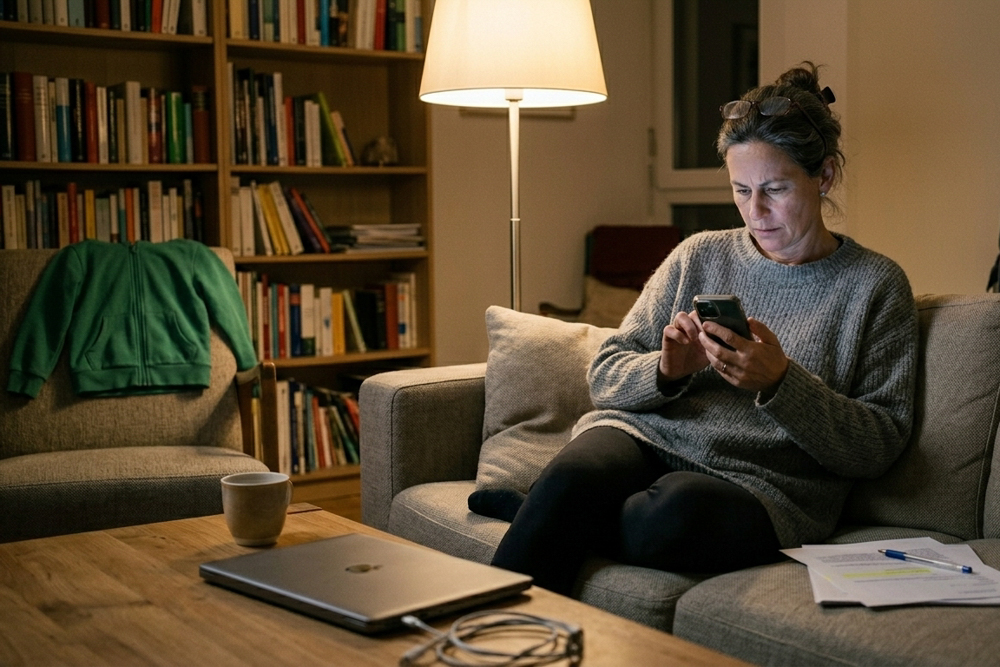
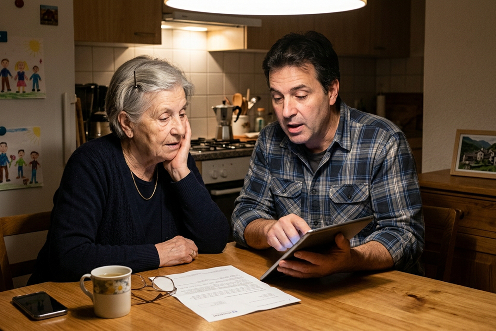
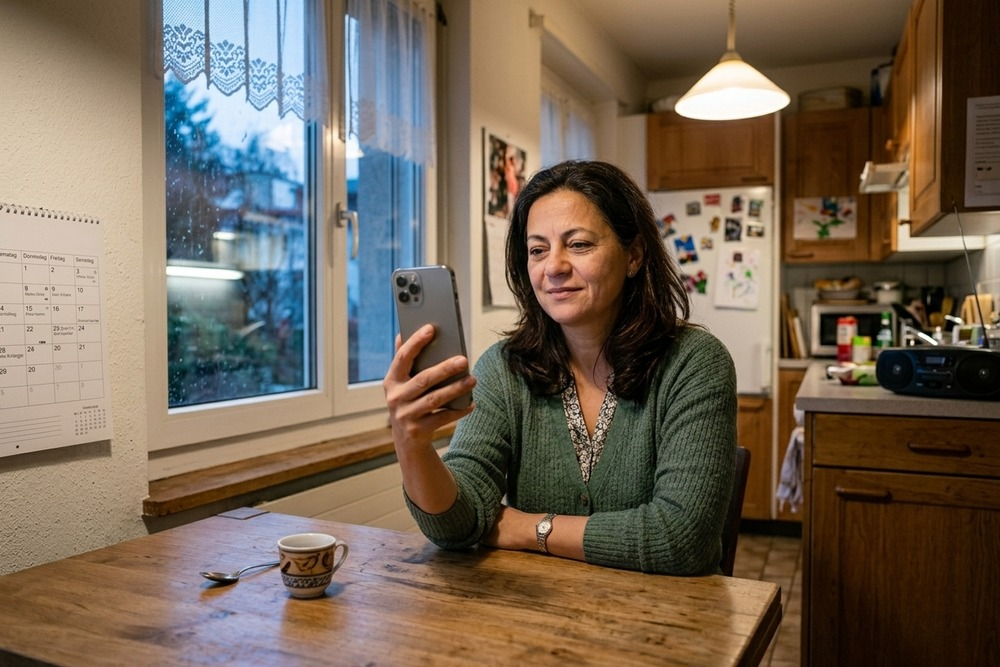

::: {.mini-nav}
[⌂ Übersicht](index.qmd)
[Zum Prototyp →](stationaer.qmd)
:::

## Wer kommt zu uns: die elektive Population {#population}

Bevor die acht Prüffiguren vorgestellt werden, ein Blick auf die
Menschen, für die der Pfad gebaut wird. Die Grafik zeigt die
Altersverteilung der elektiven Eintritte in Anteilen je Lebensjahr,
bewusst ohne Fallzahlen. Der Median liegt bei 63 Jahren. Gut die Hälfte
der Patientinnen und Patienten ist jünger als 65 und verteilt sich breit
über das Erwerbsalter. Zwischen 65 und 85 bleibt die Dichte hoch, erst
danach fällt sie steil ab. Die Gruppe ab 85 ist klein, braucht aber am
meisten Unterstützung. Für die Gestaltung heisst das: Die Seite muss für
Sandra ebenso funktionieren wie für Rosmarie, und keine der Gruppen ist
eine Randerscheinung.

{fig-alt="Säulendiagramm
der Altersverteilung von 0 bis 100 Jahren. Die Anteile steigen ab dem
Kindesalter langsam an, erreichen zwischen 60 und 80 Jahren ein breites
Plateau und fallen nach 85 steil ab. Vier Farben markieren die Gruppen
unter 65, 65 bis 74, 75 bis 84 und ab 85."}

::: {.rahmen-recht}
### Rahmen: Barrierefreiheit als Massstab

Gemeinwesen müssen ihre Internetangebote heute barrierefrei gestalten
(Art. 14 BehiG, eCH-0059: WCAG 2.1 AA). Die Revision des BehiG dehnt
die Pflicht auf Private aus, die Dienstleistungen öffentlich anbieten,
digitale eingeschlossen; geplantes Inkrafttreten 1. Januar 2027, die
Vorlage ist noch im Parlament. Für den Prototyp ist WCAG 2.1 AA deshalb
die Messlatte.

Quellen:
[BehiG, Art. 14](https://www.fedlex.admin.ch/eli/cc/2003/667/de#art_14) ·
[eCH-0059 3.0](https://www.ech.ch/de/ech/ech-0059/3.0) ·
[Botschaft BehiG-Revision, BBl 2025 300](https://www.fedlex.admin.ch/eli/fga/2025/300/de) ·
[Geschäft 25.020](https://www.parlament.ch/de/ratsbetrieb/suche-curia-vista/geschaeft?AffairId=20250020)
:::

## Die stärkste Evidenz hinter dem Konzept {#evidenz}

::: {.ev-liste}
- **Neun von zehn über 65-Jährigen sind online, ab 85 deutlich
  weniger; die Kompetenzen streuen stark.** Pro Senectute, Digital
  Seniors 2025 (Seifert, FHNW), repräsentative Befragung, n = 1455.
  [Studie (PDF)](https://be.prosenectute.ch/assets/bilder-flyer-pdf/news/2025/ps_digital_seniors_2025_studie_de.pdf)
- **49 Prozent der Schweizer Bevölkerung haben geringe
  Gesundheitskompetenz, häufiger bei über 76-Jährigen und bei
  Sprachhürden.** De Gani et al., Health Literacy Survey Schweiz
  2019–2021, Careum im Auftrag des BAG.
  [Endbericht (PDF)](https://m-pohl.net/sites/m-pohl.net/files/2021-10/Schweiz_Endbericht_HLS19_2019-2021.pdf)
- **Von den über 65-Jährigen nutzen 10 Prozent ihr Patientenportal
  selbst, 14 Prozent nur über Angehörige, 74 Prozent gar nicht.**
  Burgdorf, Fabius, Wolff, J Am Geriatr Soc 2023.
  [PubMed](https://pubmed.ncbi.nlm.nih.gov/36573382/)
- **Ältere lösen 55 Prozent der Webaufgaben, Jüngere 75 Prozent; neun
  von zehn Älteren geben sich bei Fehlern selbst die Schuld.**
  Nielsen Norman Group, Usability for Senior Citizens.
  [NN/g](https://www.nngroup.com/articles/usability-for-senior-citizens/)
- **Gesprochene Information schliesst die Verständnislücke bei
  geringer Gesundheitskompetenz.** Meppelink et al., J Med Internet
  Res 2015, Experiment mit 231 Erwachsenen ab 55.
  [Volltext](https://www.jmir.org/2015/1/e11/)
- **Bei geringer Literacy wirken Kernbotschaft zuerst und reduzierte
  Informationsdichte.** Sheridan et al., J Health Commun 2011,
  systematische Übersicht.
  [DOI](https://doi.org/10.1080/10810730.2011.604391)
- **Erfüllte Erwartungen hängen in 93 Prozent der Studien mit
  Zufriedenheit zusammen; Erwartungsmanagement ist der Hebel.**
  Hafkamp et al., EFORT Open Rev 2020, Hüft- und Knieprothetik.
  [DOI](https://doi.org/10.1302/2058-5241.5.190015)
:::

## Die acht Personen {#personen}

::: {.column-page}
```{=html}
<style>
.pa-wrap { font-size: 1.02rem; }
.pa { margin: 3.5rem 0 4.5rem; padding-top: 1rem; }
.pa + .pa { border-top: 1px solid #d9dce1; }
.pa-toc { display: flex; flex-wrap: wrap; gap: .5rem; margin: 1rem 0 2rem; }
.pa-toclink { display: inline-block; padding: .5rem .95rem; border: 1px solid; border-left-width: 6px; border-radius: 999px; background: #fff; font-weight: 600; text-decoration: none; color: #1F2A37; }
.pa-hero { width: 100%; border-radius: 12px; display: block; box-shadow: 0 2px 8px rgba(16,42,67,.12); }
.pa-kopf { display: flex; justify-content: space-between; align-items: flex-start; gap: 1rem; margin-top: 1.1rem; }
.pa-name { margin: 0; border: 0; padding: 0; font-size: 2rem; letter-spacing: -0.015em; }
.pa-meta { margin: .25rem 0 0; color: #5B6673; }
.pa-gruppe { margin: .4rem 0 0; font-size: .78rem; font-weight: 700; letter-spacing: .12em; }
.pa-badge { flex: 0 0 auto; border: 1px solid; border-radius: 10px; padding: .45rem .9rem; text-align: center; font-weight: 700; color: #1F2A37; }
.pa-badge small { display: block; font-weight: 600; color: #5B6673; font-size: .72rem; }
.pa-quote { font-size: 1.35rem; font-style: italic; color: #8C2F39; margin: 1.1rem 0 1.4rem; line-height: 1.45; max-width: none; }
.pa-grid { display: grid; grid-template-columns: 1fr 1fr; gap: .9rem; }
.pa-card { background: #EEF1F5; border: 1px solid #D9DCE1; border-radius: 10px; padding: 1rem 1.2rem; }
.pa-card h3 { margin: 0 0 .5rem; font-size: 1.02rem; color: #0B5A8E; }
.pa-card p { margin: 0 0 .6rem; max-width: none; font-size: .97rem; }
.pa-card p:last-child { margin-bottom: 0; }
.pa-haltung { background: #F3EDE2; border-color: #cdbfa3; }
.pa-haltung h3 { color: #6E5F3F; }
.pa-breit { margin-top: .9rem; background: #fff; }
.pa-braucht { background: #E9F3E6; border-color: #a9cba4; }
.pa-braucht h3 { color: #2E6B4A; }
.pa-scale { display: flex; justify-content: space-between; align-items: center; margin: 0 0 .3rem; font-size: .92rem; }
.pa-dots { white-space: nowrap; }
.pa-dot { display: inline-block; width: .72rem; height: .72rem; border-radius: 50%; margin-left: .28rem; background: #fff; border: 1.5px solid #D9DCE1; }
.pa-dot.on { background: #0B5A8E; border-color: #0B5A8E; }
.pa-klein { margin-top: .7rem; font-size: .85rem !important; color: #5B6673; }
.pa-evidenz { margin: .9rem 0 0; font-size: .85rem; color: #5B6673; max-width: none; }
.ev-liste li { margin: 0 0 .55rem; max-width: none; }
</style>
<div class="pa-toc"><a class="pa-toclink" href="#sandra" style="border-color:#4F7EA3">Sandra</a><a class="pa-toclink" href="#rosmarie" style="border-color:#B85C3F">Rosmarie</a><a class="pa-toclink" href="#claudia" style="border-color:#0B5A8E">Claudia</a><a class="pa-toclink" href="#hanspeter" style="border-color:#3B5A78">Hanspeter</a><a class="pa-toclink" href="#ruedi" style="border-color:#1F2A37">Ruedi</a><a class="pa-toclink" href="#graziella" style="border-color:#8C2F39">Graziella</a><a class="pa-toclink" href="#beat" style="border-color:#2E6B4A">Beat</a><a class="pa-toclink" href="#mirlinda" style="border-color:#7A5C92">Mirlinda</a></div>
<div class="pa-wrap">

<section class="pa" id="sandra">

<div class="pa-kopf">
  <div>
    <h2 class="pa-name">Sandra Imfeld</h2>
    <p class="pa-meta">48 Jahre · Luzern · Projektleiterin · allgemein versichert · Meniskus-Operation, stationär wegen Nachblutungsrisiko</p>
    <p class="pa-gruppe" style="color:#4F7EA3">NORMALFALL · UNTER 65 · 42 BIS 57 % DER EINTRITTE</p>
  </div>
  <div class="pa-badge" style="background:#E4EEF6;border-color:#4F7EA3"><small>Zugang</small>digital</div>
</div>
<p class="pa-quote">«Ich will das im Zug lesen, in drei Minuten, und dann wissen, was ich bis Donnerstag erledigen muss.»</p>
<div class="pa-grid">
  <div class="pa-card"><h3>Lebenssituation</h3><p>Verheiratet, zwei Kinder im Schulalter, Pendlerin. Alles auf dem Smartphone, Termine im Kalender, Post öffnet sie am Wochenende. Den Fragebogen hat sie im Zug ausgefüllt, 25 Minuten, ohne Hilfe.</p></div>
  <div class="pa-card"><h3>Gesundheit und Eingriff</h3><p>Meniskusriss, Arthroskopie in Allgemeinanästhesie. Sonst gesund, keine Medikamente. Sie versteht alles, überliest aber leicht etwas: die Nüchternheitszeit, die Abholung, das Fahrverbot nach der Narkose.</p></div>
  <div class="pa-card"><h3>Digitales Profil</h3><div class="pa-scale"><span>Smartphone im Alltag</span><span class="pa-dots"><span class="pa-dot on"></span><span class="pa-dot on"></span><span class="pa-dot on"></span><span class="pa-dot on"></span><span class="pa-dot on"></span></span></div>
<div class="pa-scale"><span>Lesen am Bildschirm</span><span class="pa-dots"><span class="pa-dot on"></span><span class="pa-dot on"></span><span class="pa-dot on"></span><span class="pa-dot on"></span><span class="pa-dot on"></span></span></div>
<div class="pa-scale"><span>Formulare allein ausfüllen</span><span class="pa-dots"><span class="pa-dot on"></span><span class="pa-dot on"></span><span class="pa-dot on"></span><span class="pa-dot on"></span><span class="pa-dot on"></span></span></div>
<div class="pa-scale"><span>Gesundheitskompetenz</span><span class="pa-dots"><span class="pa-dot on"></span><span class="pa-dot on"></span><span class="pa-dot on"></span><span class="pa-dot on"></span><span class="pa-dot"></span></span></div>
<div class="pa-scale"><span>Vertrauen in SMS und E-Mail</span><span class="pa-dots"><span class="pa-dot on"></span><span class="pa-dot on"></span><span class="pa-dot on"></span><span class="pa-dot on"></span><span class="pa-dot"></span></span></div>
<div class="pa-scale"><span>Deutsch lesen</span><span class="pa-dots"><span class="pa-dot on"></span><span class="pa-dot on"></span><span class="pa-dot on"></span><span class="pa-dot on"></span><span class="pa-dot on"></span></span></div><p class="pa-klein">Unter 65 sind praktisch alle online. Die NN/g-Kontrollgruppe (21 bis 55) löste 75 % der Aufgaben, Ältere 55 %. Sandra ist die Nutzerin, für die Webseiten normalerweise gebaut werden.</p></div>
  <div class="pa-card pa-haltung"><h3>Haltung und Wahrnehmung</h3><p>Die Klinik ist für sie ein Dienstleister wie die Bank: Link öffnen, erledigen, Bestätigung erhalten. Sie vertraut der Institution und sieht dem Eingriff gelassen entgegen. Lange Erklärungen zu Dingen, die sie gar nicht gefragt hat, überspringt sie.</p>
<p>Was sie stört, ist Unklarheit über Zeiten. Sie plant in Stunden, weil sie um 16 Uhr die Kinder hat. Eine Wartezeit akzeptiert sie, wenn sie vorher weiss, wie lang sie werden kann.</p></div>
</div>
<div class="pa-card pa-breit"><h3>Was Sandra wissen will, und in welcher Reihenfolge</h3><p>Zuerst: was muss ich bis wann erledigen, als Liste. Dann: wann muss ich wo sein, wie lange dauert der Tag, wann kann mich jemand abholen. Dann: was darf ich am Morgen essen und trinken, konkret mit Uhrzeit. Erst danach: wie läuft die Operation. Versicherungsleistungen, Anästhesieverfahren und Bauprojekt überspringt sie.</p></div>
<div class="pa-card pa-breit pa-braucht"><h3>Was die Seite und der Fahrplan für Sandra leisten müssen</h3><p>Eine Kurzfassung oben, die fünf Aufgaben bis zum Eintritt mit Datum, abhakbar. Zeitachse statt Stationen, Wartezeit als Spanne mit dem Hinweis, dass die Operationszeit erst am Eintrittstag feststeht. Checklisten als Seite, nicht als PDF. SMS und E-Mail sind für sie richtig. Was den Älteren hilft, eine Spalte und die Kernbotschaft zuerst, passt auch für sie; sie scrollt einfach schneller.</p></div>
<p class="pa-evidenz"><strong>Woher die Persona kommt.</strong> Altersverteilung elektive Eintritte 2026 (unter 65: 57 % mit Anästhesiekontakt, 42 % anästhesiefern); NN/g 2013 (Kontrollgruppe 21 bis 55: 75 % Erfolg); Maramba 2022 (präoperativer Online-Bogen, Median 47 min bei Medianalter 46); Sheridan 2011 (Kernbotschaft zuerst); Thompson 1996 (erklärte Wartezeit wird akzeptiert).</p>
</section>

<section class="pa" id="rosmarie">

<div class="pa-kopf">
  <div>
    <h2 class="pa-name">Rosmarie Bühler</h2>
    <p class="pa-meta">83 Jahre · Emmen LU · verwitwet · Knie-Totalprothese, Eintritt am Operationstag</p>
    <p class="pa-gruppe" style="color:#B85C3F">GRUPPE 85+ (IM ÜBERGANG) · 4 BIS 6 % DER EINTRITTE</p>
  </div>
  <div class="pa-badge" style="background:#F3EDE2;border-color:#9A8A6A"><small>Zugang</small>analog</div>
</div>
<p class="pa-quote">«Ich habe das SMS schon gesehen, aber ich drücke nichts an, was ich nicht kenne. Die Claudia schaut das dann.»</p>
<div class="pa-grid">
  <div class="pa-card"><h3>Lebenssituation</h3><p>Lebt allein, Tochter Claudia kommt zweimal die Woche. Tastenhandy, Festnetz, keine E-Mail. Liest auf Papier, mit Lesebrille, und hebt jeden Brief der Klinik in einer Mappe auf.</p></div>
  <div class="pa-card"><h3>Gesundheit und Eingriff</h3><p>Knie-Totalprothese. Vorhofflimmern mit Marcoumar, Hörgerät beidseits, am Telefon anstrengend. Geistig klar, etwas langsamer. Fragebogen nicht ausgefüllt, analoger präoperativer Prozess.</p></div>
  <div class="pa-card"><h3>Digitales Profil</h3><div class="pa-scale"><span>Smartphone im Alltag</span><span class="pa-dots"><span class="pa-dot on"></span><span class="pa-dot"></span><span class="pa-dot"></span><span class="pa-dot"></span><span class="pa-dot"></span></span></div>
<div class="pa-scale"><span>Lesen am Bildschirm</span><span class="pa-dots"><span class="pa-dot on"></span><span class="pa-dot"></span><span class="pa-dot"></span><span class="pa-dot"></span><span class="pa-dot"></span></span></div>
<div class="pa-scale"><span>Formulare allein ausfüllen</span><span class="pa-dots"><span class="pa-dot"></span><span class="pa-dot"></span><span class="pa-dot"></span><span class="pa-dot"></span><span class="pa-dot"></span></span></div>
<div class="pa-scale"><span>Gesundheitskompetenz</span><span class="pa-dots"><span class="pa-dot on"></span><span class="pa-dot on"></span><span class="pa-dot"></span><span class="pa-dot"></span><span class="pa-dot"></span></span></div>
<div class="pa-scale"><span>Vertrauen in SMS und E-Mail</span><span class="pa-dots"><span class="pa-dot on"></span><span class="pa-dot"></span><span class="pa-dot"></span><span class="pa-dot"></span><span class="pa-dot"></span></span></div>
<div class="pa-scale"><span>Deutsch lesen</span><span class="pa-dots"><span class="pa-dot on"></span><span class="pa-dot on"></span><span class="pa-dot on"></span><span class="pa-dot on"></span><span class="pa-dot on"></span></span></div><p class="pa-klein">Ab 85: 40 % offline, 53 % mit Smartphone, 72 % der Frauen über 80 brauchen beim Ausfüllen Hilfe. Rosmarie liegt am unteren Rand.</p></div>
  <div class="pa-card pa-haltung"><h3>Haltung und Wahrnehmung</h3><p>Sie vertraut der Klinik und den Ärzten. Sie möchte, dass man ihr sagt, was sie tun soll: einmal, deutlich, auf Papier. Digitale Angebote empfindet sie als Zumutung («zu kompliziert»); wenn etwas schiefgeht, sucht sie den Fehler bei sich.</p>
<p>Vor der Operation hat sie wenig Angst. Ihre Sorge ist, etwas falsch zu machen: zur falschen Zeit zu kommen, das falsche Medikament zu nehmen, etwas zu vergessen.</p></div>
</div>
<div class="pa-card pa-breit"><h3>Was Rosmarie wissen will, und in welcher Reihenfolge</h3><p>Zuerst: wann muss ich wo sein, und wer holt mich ab. Dann: was darf ich am Morgen nehmen, Marcoumar ja oder nein. Dann: was muss ich mitbringen. Dann: wie lange bleibe ich, wer kümmert sich danach um mich. Alles Weitere soll ihr jemand sagen, wenn es so weit ist. Sie möchte sich darauf verlassen können, dass die Klinik das tut.</p></div>
<div class="pa-card pa-breit pa-braucht"><h3>Was die Seite und der Fahrplan für Rosmarie leisten müssen</h3><p>Der Brief ist ihr Fahrplan: eine Seite, Zeitachse, Nüchternheit, Medikamente, Telefonnummer gross, 14 Punkt, zum Aufhängen. Fehlt die Handynummer, ruft die Disposition auf dem Festnetz an; die SMS-Regel entfällt für sie. Der Anruf der Anästhesie am Vortag ist ihr persönlichster Kontakt und trägt ihre Medikamentenfragen. Die Webseite erreicht sie über Claudia: druckbar, ohne Login.</p></div>
<p class="pa-evidenz"><strong>Woher die Persona kommt.</strong> Digital Seniors 2025 (85+: 60 % online, 53 % Smartphone; Offliner: «zu kompliziert»); Riedl 2023 (72 % der Frauen über 80 brauchen Hilfe); BAG/Careum 2023 (81 % der über 76-Jährigen mit geringer digitaler Gesundheitskompetenz); Gordon 2019 (Gedrucktes, OR 2.8 bei 76 bis 85); NN/g 2013 (90 % geben sich bei Fehlern selbst die Schuld); Özbek 2025 (Anruf am Vortag senkt Angst).</p>
</section>

<section class="pa" id="claudia">

<div class="pa-kopf">
  <div>
    <h2 class="pa-name">Claudia Bühler-Steiner</h2>
    <p class="pa-meta">56 Jahre · Rothenburg LU · Sachbearbeiterin, 80 % · Tochter von Rosmarie</p>
    <p class="pa-gruppe" style="color:#0B5A8E">ANGEHÖRIGE ALS MITNUTZENDE · LIEST FÜR DIE MUTTER</p>
  </div>
  <div class="pa-badge" style="background:#E4EEF6;border-color:#4F7EA3"><small>Zugang</small>digital, stellvertretend</div>
</div>
<p class="pa-quote">«Ich lese das abends auf dem Handy, wenn die Kinder im Bett sind. Dann drucke ich es aus und lege es Mami auf den Tisch.»</p>
<div class="pa-grid">
  <div class="pa-card"><h3>Lebenssituation</h3><p>Zwei Jugendliche, Vollzeit im Kopf. Organisiert für die Mutter Termine, Rezepte, Fahrten. Googelt «St. Anna Eintritt» und landet auf einer Unterseite, abends, in Eile, auf dem Smartphone.</p></div>
  <div class="pa-card"><h3>Gesundheit und Eingriff</h3><p>Selbst gesund. Sie trägt die Logistik und einen Teil der Verantwortung: Medikamentenliste, Abholung, erste Woche zu Hause, Treppe in der Wohnung der Mutter.</p></div>
  <div class="pa-card"><h3>Digitales Profil</h3><div class="pa-scale"><span>Smartphone im Alltag</span><span class="pa-dots"><span class="pa-dot on"></span><span class="pa-dot on"></span><span class="pa-dot on"></span><span class="pa-dot on"></span><span class="pa-dot on"></span></span></div>
<div class="pa-scale"><span>Lesen am Bildschirm</span><span class="pa-dots"><span class="pa-dot on"></span><span class="pa-dot on"></span><span class="pa-dot on"></span><span class="pa-dot on"></span><span class="pa-dot on"></span></span></div>
<div class="pa-scale"><span>Formulare allein ausfüllen</span><span class="pa-dots"><span class="pa-dot on"></span><span class="pa-dot on"></span><span class="pa-dot on"></span><span class="pa-dot on"></span><span class="pa-dot on"></span></span></div>
<div class="pa-scale"><span>Gesundheitskompetenz</span><span class="pa-dots"><span class="pa-dot on"></span><span class="pa-dot on"></span><span class="pa-dot on"></span><span class="pa-dot"></span><span class="pa-dot"></span></span></div>
<div class="pa-scale"><span>Vertrauen in SMS und E-Mail</span><span class="pa-dots"><span class="pa-dot on"></span><span class="pa-dot on"></span><span class="pa-dot on"></span><span class="pa-dot"></span><span class="pa-dot"></span></span></div>
<div class="pa-scale"><span>Deutsch lesen</span><span class="pa-dots"><span class="pa-dot on"></span><span class="pa-dot on"></span><span class="pa-dot on"></span><span class="pa-dot on"></span><span class="pa-dot on"></span></span></div><p class="pa-klein">14 % der über 65-Jährigen werden digital ausschliesslich über Angehörige erreicht, 74 % gar nicht. Claudia ist dieser Kanal.</p></div>
  <div class="pa-card pa-haltung"><h3>Haltung und Wahrnehmung</h3><p>Sie ist Vermittlerin und Organisatorin, und die Klinik kennt sie nicht. Sie möchte wissen, was ihre Rolle ist: darf sie mit, wo wartet sie, wen ruft sie an. Der Klinik gegenüber ist sie loyal; bei allem, was auf dem Handy der Mutter ankommt, ist sie vorsichtig.</p>
<p>Ihre Sorge gilt der Zeit nach dem Austritt: wer ist da, wenn Mami nach drei Tagen heimkommt. Die Vorbereitung traut sie der Klinik zu; die Zeit danach organisiert sie selbst.</p></div>
</div>
<div class="pa-card pa-breit"><h3>Was Claudia wissen will, und in welcher Reihenfolge</h3><p>Zuerst: was sie für die Mutter erledigen muss und bis wann. Dann: ob sie am Eintrittstag dabei sein darf und wie lange es dauert. Dann: was nach dem Austritt auf sie zukommt, Spitex, Hilfsmittel, Nachkontrolle. Dann: wen sie anrufen kann, wenn etwas unklar ist, und zu welchen Zeiten. Medizinische Details liest sie nur, wenn sie für die Organisation zu Hause wichtig sind.</p></div>
<div class="pa-card pa-breit pa-braucht"><h3>Was die Seite und der Fahrplan für Claudia leisten müssen</h3><p>Ein Einstieg «Wenn Sie jemanden begleiten» mit ihren Aufgaben, der Frage nach dem Mitkommen und dem Blick auf die Zeit nach dem Austritt. Seiten ohne Login, teilbar, druckbar ohne Verlust; ein Merkblatt auf einer Seite. Ein Abschnitt «So sehen echte Nachrichten der Klinik aus». Auf dem Smartphone: eine Spalte, Telefonnummer auf jedem Bildschirm, Zoom frei.</p></div>
<p class="pa-evidenz"><strong>Woher die Persona kommt.</strong> Burgdorf, Fabius und Wolff 2023 (Portalnutzung über 65: 14 % nur Angehörige, 74 % keine); Hladkowicz 2024 und Keny 2026 («wissen, was zu erwarten ist» und die Zeit nach dem Austritt als Hauptbedürfnisse von Angehörigen); Latulipe 2018 (geteilte Logins); NN/g 2013 (Einstieg über Suchmaschinen); WCAG 3.2.6.</p>
</section>

<section class="pa" id="hanspeter">

<div class="pa-kopf">
  <div>
    <h2 class="pa-name">Hanspeter Zemp</h2>
    <p class="pa-meta">72 Jahre · Meggen LU · pensionierter Maschineningenieur · privatversichert · Prostata-Operation</p>
    <p class="pa-gruppe" style="color:#3B5A78">GRUPPE 65 BIS 74 · DIGITAL SELBSTÄNDIG · METHODISCH</p>
  </div>
  <div class="pa-badge" style="background:#E4EEF6;border-color:#4F7EA3"><small>Zugang</small>digital</div>
</div>
<p class="pa-quote">«Ich habe mir alles notiert. Wenn dann etwas anders läuft, als es angekündigt war, will ich wissen, warum.»</p>
<div class="pa-grid">
  <div class="pa-card"><h3>Lebenssituation</h3><p>iPhone und PC, Online-Banking, E-Mail täglich. Liest eine Seite ganz, bevor er klickt, und führt eine Liste mit Schritten und Nummern. Fragebogen am Abend des Erhalts ausgefüllt, 50 Minuten. Druckt, was er behalten will.</p></div>
  <div class="pa-card"><h3>Gesundheit und Eingriff</h3><p>Benigne Prostatahyperplasie, Spinalanästhesie. Hypertonie, sonst fit. Kontrastsehen altersgemäss reduziert. Medizinisch unkompliziert. Sein Thema ist, ob das, was er erlebt, zu dem passt, was angekündigt war.</p></div>
  <div class="pa-card"><h3>Digitales Profil</h3><div class="pa-scale"><span>Smartphone im Alltag</span><span class="pa-dots"><span class="pa-dot on"></span><span class="pa-dot on"></span><span class="pa-dot on"></span><span class="pa-dot on"></span><span class="pa-dot on"></span></span></div>
<div class="pa-scale"><span>Lesen am Bildschirm</span><span class="pa-dots"><span class="pa-dot on"></span><span class="pa-dot on"></span><span class="pa-dot on"></span><span class="pa-dot on"></span><span class="pa-dot"></span></span></div>
<div class="pa-scale"><span>Formulare allein ausfüllen</span><span class="pa-dots"><span class="pa-dot on"></span><span class="pa-dot on"></span><span class="pa-dot on"></span><span class="pa-dot on"></span><span class="pa-dot on"></span></span></div>
<div class="pa-scale"><span>Gesundheitskompetenz</span><span class="pa-dots"><span class="pa-dot on"></span><span class="pa-dot on"></span><span class="pa-dot on"></span><span class="pa-dot on"></span><span class="pa-dot"></span></span></div>
<div class="pa-scale"><span>Vertrauen in SMS und E-Mail</span><span class="pa-dots"><span class="pa-dot on"></span><span class="pa-dot on"></span><span class="pa-dot on"></span><span class="pa-dot on"></span><span class="pa-dot"></span></span></div>
<div class="pa-scale"><span>Deutsch lesen</span><span class="pa-dots"><span class="pa-dot on"></span><span class="pa-dot on"></span><span class="pa-dot on"></span><span class="pa-dot on"></span><span class="pa-dot on"></span></span></div><p class="pa-klein">97 % der 65- bis 74-Jährigen sind online, 95 % mit Smartphone. Hanspeter nutzt beides, bevorzugt aber den PC für Dinge, die er behalten will.</p></div>
  <div class="pa-card pa-haltung"><h3>Haltung und Wahrnehmung</h3><p>Er sieht die Klinik wie einen Lieferanten: Zusagen gelten. Er möchte vollständige und widerspruchsfreie Information; zwei Seiten, die Verschiedenes sagen, sind für ihn ein Qualitätsmangel. Wartezeit akzeptiert er, sobald sie begründet ist.</p>
<p>Er vertraut Zahlen und Abläufen. Ein Redesign, nach dem seine Notizen nicht mehr stimmen, ärgert ihn; eine Seite, die ihm Gründe nennt, überzeugt ihn.</p></div>
</div>
<div class="pa-card pa-breit"><h3>Was Hanspeter wissen will, und in welcher Reihenfolge</h3><p>Zuerst: der Ablauf des Eintrittstags, Schritt für Schritt, mit Zeiten und Orten. Dann: was er vorbereiten muss, vollständig, mit Begründung. Dann: wie die Spinalanästhesie abläuft und was er dabei spürt. Dann: was im Zimmer und bei der Hotellerie gilt, weil er es bezahlt. Zuletzt: wen er anruft, wenn etwas nicht stimmt. Er will alles vorher wissen und liest es zweimal.</p></div>
<div class="pa-card pa-breit pa-braucht"><h3>Was die Seite und der Fahrplan für Hanspeter leisten müssen</h3><p>Eine Zeitachse, auf der alles steht, was er erleben wird, inklusive dessen, was wegen des Umbaus anders ist als auf der Leistungsseite, mit Grund, Horizont und Angebot; derselbe Wortlaut auf beiden Seiten. Besuchte Links sichtbar, konsistente Navigation und Benennung. Ein Video, das den Tag real zeigt, mit einer Pflegefachperson, die erzählt. Für ihn zählt, ob das Erlebnis zur Erwartung passt.</p></div>
<p class="pa-evidenz"><strong>Woher die Persona kommt.</strong> NN/g 2013 (95 % der Älteren arbeiten methodisch, 50 % führen Listen; Redesigns entwerten sie); Thompson 1996 und Hafkamp 2020 (Erfüllung der Erwartung erklärt Zufriedenheit); Zhang 2025 (Erwartungskalibrierung senkt Unzufriedenheit); Powell 2016 (prozedurale und sensorische Information wirkt); Bol 2015 (erzählendes Video).</p>
</section>

<section class="pa" id="ruedi">

<div class="pa-kopf">
  <div>
    <h2 class="pa-name">Ruedi Kaufmann</h2>
    <p class="pa-meta">70 Jahre · Weggis LU · ehemaliger Inhaber eines Maschinenbaubetriebs, verkauft 2022 · privatversichert · Hüft-Totalprothese</p>
    <p class="pa-gruppe" style="color:#1F2A37">GRUPPE 65 BIS 74 · PRIVAT · ANSPRUCH UND DELEGATION</p>
  </div>
  <div class="pa-badge" style="background:#E4EEF6;border-color:#4F7EA3"><small>Zugang</small>digital, delegiert</div>
</div>
<p class="pa-quote">«Ich lese das nicht nach. Jemand soll wissen, wer ich bin, und mir sagen, was läuft.»</p>
<div class="pa-grid">
  <div class="pa-card"><h3>Lebenssituation</h3><p>Verheiratet, Haus mit Seeblick, Golf und Segeln. Hat 40 Jahre entschieden und delegiert; Administratives erledigt seine Frau Monika. iPad und iPhone, mailt kurz. Den Fragebogen hat Monika ausgefüllt, er hat unterschrieben.</p></div>
  <div class="pa-card"><h3>Gesundheit und Eingriff</h3><p>Coxarthrose rechts, Hüft-Totalprothese, will in acht Wochen wieder auf den Platz. Hypertonie, Vorhofflimmern mit Eliquis, Schlafapnoe unbehandelt. Mittleres Risiko. Nach der Eliquis-Pause und dem Schnarchen hat bisher nur Monika am Fragebogen geantwortet, er selbst wurde nie gefragt.</p></div>
  <div class="pa-card"><h3>Digitales Profil</h3><div class="pa-scale"><span>Smartphone im Alltag</span><span class="pa-dots"><span class="pa-dot on"></span><span class="pa-dot on"></span><span class="pa-dot on"></span><span class="pa-dot on"></span><span class="pa-dot"></span></span></div>
<div class="pa-scale"><span>Lesen am Bildschirm</span><span class="pa-dots"><span class="pa-dot on"></span><span class="pa-dot on"></span><span class="pa-dot on"></span><span class="pa-dot on"></span><span class="pa-dot"></span></span></div>
<div class="pa-scale"><span>Formulare allein ausfüllen</span><span class="pa-dots"><span class="pa-dot on"></span><span class="pa-dot on"></span><span class="pa-dot on"></span><span class="pa-dot"></span><span class="pa-dot"></span></span></div>
<div class="pa-scale"><span>Gesundheitskompetenz</span><span class="pa-dots"><span class="pa-dot on"></span><span class="pa-dot on"></span><span class="pa-dot on"></span><span class="pa-dot"></span><span class="pa-dot"></span></span></div>
<div class="pa-scale"><span>Vertrauen in SMS und E-Mail</span><span class="pa-dots"><span class="pa-dot on"></span><span class="pa-dot on"></span><span class="pa-dot on"></span><span class="pa-dot on"></span><span class="pa-dot"></span></span></div>
<div class="pa-scale"><span>Deutsch lesen</span><span class="pa-dots"><span class="pa-dot on"></span><span class="pa-dot on"></span><span class="pa-dot on"></span><span class="pa-dot on"></span><span class="pa-dot on"></span></span></div><p class="pa-klein">Kompetent, aber ungeduldig: liest Überschriften und delegiert den Rest. In den Zahlen gleicht er Hanspeter, im Verhalten unterscheidet er sich deutlich.</p></div>
  <div class="pa-card pa-haltung"><h3>Haltung und Wahrnehmung</h3><p>Er kauft eine Leistung und erwartet Führung: einen Namen, eine Nummer, jemanden, der ihn kennt. Information, die er sich selbst holen muss, empfindet er als Servicelücke. Er respektiert Fachkompetenz und erwartet, dass sie sich zeigt, beim Chefarzt und beim Empfang gleichermassen.</p>
<p>Seine Sorge ist Kontrollverlust: warten, ohne zu wissen worauf, und niemand ist zuständig. Was ihn ärgert, sagt er der Direktion persönlich; den Rückmeldebogen füllt er kaum aus.</p></div>
</div>
<div class="pa-card pa-breit"><h3>Was Ruedi wissen will, und in welcher Reihenfolge</h3><p>Zuerst: wer ist für mich zuständig, mit Namen und Nummer. Dann: wann geht es los und wie lange dauert es, und wann werde ich informiert, wenn sich etwas verschiebt. Dann: was von dem, was ich bezahle, gilt am Eintrittstag und was erst nachher. Dann: wann bin ich wieder auf dem Platz. Die Vorbereitung soll ihm jemand am Telefon erklären.</p></div>
<div class="pa-card pa-breit pa-braucht"><h3>Was die Seite und der Fahrplan für Ruedi leisten müssen</h3><p>Eine Ansprechperson mit Namen und Direktnummer auf Brief und Seite. Erwartungen werden vor dem Eintritt auf der Leistungsseite gesetzt, bevor der Empfang sie korrigieren muss: was am Eintrittstag für alle gleich ist und was er bezahlt (Zimmer, Küche, Wahlarzt). Am Eintrittstag ein Statusupdate alle 30 Minuten, auch ohne Neuigkeit. Der Anruf der Anästhesie fragt ihn selbst nach Medikamenten und Risiken, zusätzlich zu Monikas Angaben.</p></div>
<p class="pa-evidenz"><strong>Woher die Persona kommt.</strong> Hafkamp 2020 (Erfüllung der Erwartung erklärt Zufriedenheit in 93 % der Studien, Hüft- und Knieprothetik); Cooke 2006 (76 % erwarten ein Statusupdate alle 30 Minuten); Thompson 1996 (Information und Erklärung prädizieren Zufriedenheit); Ballacchino 2025 (Ältere wollen Kontakt mit der Anästhesie vor dem OP-Tag: «die sollen meine Krankheiten kennen»); Elliott 2008 (Stellvertreter-Antworten weichen von Selbstauskunft ab).</p>
</section>

<section class="pa" id="graziella">

<div class="pa-kopf">
  <div>
    <h2 class="pa-name">Graziella Bernasconi</h2>
    <p class="pa-meta">78 Jahre · aus Bellinzona TI, seit 2021 beim Sohn in Horw LU · Muttersprache Italienisch · Hüft-Totalprothese</p>
    <p class="pa-gruppe" style="color:#8C2F39">GRUPPE 75 BIS 84 · SPRACHHÜRDE · HILFE IST DIE REGEL</p>
  </div>
  <div class="pa-badge" style="background:#E4EEF6;border-color:#4F7EA3"><small>Zugang</small>digital mit Hilfe</div>
</div>
<p class="pa-quote">«Capisco il tedesco quando parlano piano. Sullo schermo è un'altra cosa. Marco mi legge tutto, poi gli chiedo tre volte.»</p>
<div class="pa-grid">
  <div class="pa-card"><h3>Lebenssituation</h3><p>Witwe, lebt bei Sohn Marco und Familie. Deutsch mündlich für den Alltag; Lesen fällt ihr schwer, Fachwörter versteht sie selten. Smartphone für WhatsApp und Videoanrufe ins Tessin. Fragebogen mit Marco am Tablet ausgefüllt, zwei Abende.</p></div>
  <div class="pa-card"><h3>Gesundheit und Eingriff</h3><p>Hüft-Totalprothese. Diabetes Typ 2 mit Tabletten, Hörminderung ohne Hörgerät. Nüchternheit, Diabetesmedikamente, Blutverdünner: drei Regeln, die sie selbst verstehen muss, auch wenn Marco übersetzt.</p></div>
  <div class="pa-card"><h3>Digitales Profil</h3><div class="pa-scale"><span>Smartphone im Alltag</span><span class="pa-dots"><span class="pa-dot on"></span><span class="pa-dot on"></span><span class="pa-dot"></span><span class="pa-dot"></span><span class="pa-dot"></span></span></div>
<div class="pa-scale"><span>Lesen am Bildschirm</span><span class="pa-dots"><span class="pa-dot on"></span><span class="pa-dot"></span><span class="pa-dot"></span><span class="pa-dot"></span><span class="pa-dot"></span></span></div>
<div class="pa-scale"><span>Formulare allein ausfüllen</span><span class="pa-dots"><span class="pa-dot on"></span><span class="pa-dot"></span><span class="pa-dot"></span><span class="pa-dot"></span><span class="pa-dot"></span></span></div>
<div class="pa-scale"><span>Gesundheitskompetenz</span><span class="pa-dots"><span class="pa-dot on"></span><span class="pa-dot on"></span><span class="pa-dot"></span><span class="pa-dot"></span><span class="pa-dot"></span></span></div>
<div class="pa-scale"><span>Vertrauen in SMS und E-Mail</span><span class="pa-dots"><span class="pa-dot on"></span><span class="pa-dot on"></span><span class="pa-dot"></span><span class="pa-dot"></span><span class="pa-dot"></span></span></div>
<div class="pa-scale"><span>Deutsch lesen</span><span class="pa-dots"><span class="pa-dot on"></span><span class="pa-dot on"></span><span class="pa-dot"></span><span class="pa-dot"></span><span class="pa-dot"></span></span></div><p class="pa-klein">88 % der 75- bis 84-Jährigen sind online; 81 % der über 76-Jährigen haben geringe digitale Gesundheitskompetenz, bei Sprachhürden tiefer. Graziella liest Deutsch Wort für Wort.</p></div>
  <div class="pa-card pa-haltung"><h3>Haltung und Wahrnehmung</h3><p>Sie vertraut Menschen mehr als Texten: dem Hausarzt, dem Sohn, der Pflegefachfrau, die langsam spricht. Schriftliches auf Deutsch erlebt sie als Prüfung, und sie schämt sich, nachzufragen; deshalb fragt sie Marco dreimal, bevor sie die Klinik einmal fragt.</p>
<p>Ihre Sorge: etwas Wichtiges nicht verstanden zu haben und deshalb Schaden zu nehmen. Bilder beruhigen sie mehr als Worte; ein Gesicht, das sie wiedererkennt, am meisten.</p></div>
</div>
<div class="pa-card pa-breit"><h3>Was Graziella wissen will, und in welcher Reihenfolge</h3><p>Zuerst: die drei Regeln, die sie selbst einhalten muss, Essen, Zuckertabletten, Blutverdünner, in einer Sprache, die sie versteht. Dann: wer sie am Eintrittstag empfängt und ob Marco dabei sein darf. Dann: wie der Tag aussieht, am liebsten in Bildern. Dann: wie lange sie bleibt und wer ihr danach hilft. Begründungen, Verfahren und Versicherungsfragen überlässt sie Marco.</p></div>
<div class="pa-card pa-breit pa-braucht"><h3>Was die Seite und der Fahrplan für Graziella leisten müssen</h3><p>Einfache Sprache mit ganzen Sätzen: «Ab sechs Stunden vor dem Eintritt nichts mehr essen» statt «nüchtern». Die Sicherheitsregeln, die sie selbst einhalten muss, als eigener Block zuerst, und als italienisches Merkblatt auf einer Seite. Das Video: gesprochen, mit mitlaufendem Text, langsam, Untertitel wahlweise italienisch, reale Bilder von Empfang und Station. Für den Anruf der Anästhesie: Marco als Kontaktperson erfassen.</p></div>
<p class="pa-evidenz"><strong>Woher die Persona kommt.</strong> BAG/Careum 2021 und 2023 (geringe Gesundheitskompetenz häufiger bei Sprachhürden und über 76); Digital Seniors 2025 (75 bis 84: 88 % online); Riedl 2023 (Frauen 71 bis 80: 45 % brauchen Hilfe); Schatz 2017 (Einfache Sprache gleicht den Altersunterschied aus); Meppelink 2015 (gesprochene Animation bei geringer Kompetenz); Fenesi 2015 (mitlaufender Text hilft Älteren).</p>
</section>

<section class="pa" id="beat">

<div class="pa-kopf">
  <div>
    <h2 class="pa-name">Beat Odermatt</h2>
    <p class="pa-meta">67 Jahre · Giswil OW · Landwirt, Hof übergeben · halbprivat · Leistenhernie beidseits</p>
    <p class="pa-gruppe" style="color:#2E6B4A">GRUPPE 65 BIS 74 · GERINGE GESUNDHEITSKOMPETENZ</p>
  </div>
  <div class="pa-badge" style="background:#E4EEF6;border-color:#4F7EA3"><small>Zugang</small>digital, zögernd</div>
</div>
<p class="pa-quote">«Ein SMS mit einem Link, da drücke ich nicht drauf. Das hat man uns bei der Bank gesagt. Ich rufe lieber an.»</p>
<div class="pa-grid">
  <div class="pa-card"><h3>Lebenssituation</h3><p>Android-Smartphone, grosse Hände, tippt mit dem Zeigefinger. Liest kurz und ungern. Das Fragebogen-SMS hat er für Betrug gehalten und gelöscht; nach dem Brief rief er an und füllte den Bogen mit seiner Frau am Küchentisch aus.</p></div>
  <div class="pa-card"><h3>Gesundheit und Eingriff</h3><p>Leistenhernie, Allgemeinanästhesie. Diabetes Typ 2 mit Metformin, Übergewicht, Schlafapnoe mit CPAP, raucht. Versteht «nüchtern» als «nichts essen» und trinkt den Milchkaffee.</p></div>
  <div class="pa-card"><h3>Digitales Profil</h3><div class="pa-scale"><span>Smartphone im Alltag</span><span class="pa-dots"><span class="pa-dot on"></span><span class="pa-dot on"></span><span class="pa-dot on"></span><span class="pa-dot"></span><span class="pa-dot"></span></span></div>
<div class="pa-scale"><span>Lesen am Bildschirm</span><span class="pa-dots"><span class="pa-dot on"></span><span class="pa-dot on"></span><span class="pa-dot"></span><span class="pa-dot"></span><span class="pa-dot"></span></span></div>
<div class="pa-scale"><span>Formulare allein ausfüllen</span><span class="pa-dots"><span class="pa-dot on"></span><span class="pa-dot on"></span><span class="pa-dot"></span><span class="pa-dot"></span><span class="pa-dot"></span></span></div>
<div class="pa-scale"><span>Gesundheitskompetenz</span><span class="pa-dots"><span class="pa-dot on"></span><span class="pa-dot"></span><span class="pa-dot"></span><span class="pa-dot"></span><span class="pa-dot"></span></span></div>
<div class="pa-scale"><span>Vertrauen in SMS und E-Mail</span><span class="pa-dots"><span class="pa-dot on"></span><span class="pa-dot"></span><span class="pa-dot"></span><span class="pa-dot"></span><span class="pa-dot"></span></span></div>
<div class="pa-scale"><span>Deutsch lesen</span><span class="pa-dots"><span class="pa-dot on"></span><span class="pa-dot on"></span><span class="pa-dot on"></span><span class="pa-dot on"></span><span class="pa-dot on"></span></span></div><p class="pa-klein">42 % der über 65-Jährigen sehen ihre Daten gefährdet; Ältere erkennen Phishing schlechter. Beat klickt deshalb gar nichts an.</p></div>
  <div class="pa-card pa-haltung"><h3>Haltung und Wahrnehmung</h3><p>Er nimmt Dinge wörtlich und erwartet eine klare Anweisung; bei drei Wahlmöglichkeiten steigt er aus. Digitalen Nachrichten von aussen misstraut er, einer Stimme am Telefon vertraut er sofort. Ärzten glaubt er; Formularen gegenüber bleibt er skeptisch.</p>
<p>Seine Sorge ist, dumm dazustehen: eine Frage falsch zu verstehen, auf dem Bildschirm danebenzutippen, etwas falsch zu machen. Dann gibt er sich die Schuld und schweigt.</p></div>
</div>
<div class="pa-card pa-breit"><h3>Was Beat wissen will, und in welcher Reihenfolge</h3><p>Zuerst: was er am Morgen des Eintritts darf und was nicht, mit Uhrzeiten statt Fachbegriffen. Dann: welche Tabletten er nimmt und welche nicht, und ob das CPAP-Gerät mitkommt. Dann: wo er hin muss und wen er anruft, wenn etwas ist. Das genügt ihm. Mehr Text verwirrt ihn eher.</p></div>
<div class="pa-card pa-breit pa-braucht"><h3>Was die Seite und der Fahrplan für Beat leisten müssen</h3><p>«So sehen echte Nachrichten der Klinik aus», und der Brief kündigt die SMS an. Telefonnummer auf jedem Bildschirm; Anrufen ist für ihn der normale Weg. Kernbotschaft zuerst, als Aufgabe mit Uhrzeit: «Ab 02:00 Uhr nichts mehr essen. Wasser, Tee, schwarzer Kaffee bis 06:00 Uhr.» Überschriften als Fragen. Knöpfe mindestens 56 Pixel. Ein Hinweis auf dem Merkblatt am Kühlschrank, eigene Geräte und Medikamente mitzubringen.</p></div>
<p class="pa-evidenz"><strong>Woher die Persona kommt.</strong> Digital Seniors 2025 (42 % sehen Datensicherheit gefährdet); Lin 2019 und Pehlivanoglu 2024 (Phishing-Anfälligkeit steigt mit dem Alter); Babicz 2022; BAG/Careum 2021 (49 % geringe Gesundheitskompetenz); Sheridan 2011 (Kernbotschaft zuerst); Leitão 2012 (Berührungsziele ab 14 mm); NN/g 2013 (90 % geben sich selbst die Schuld); Wildenbos 2018 (Motivation und Kognition als Hauptbarrieren).</p>
</section>

<section class="pa" id="mirlinda">

<div class="pa-kopf">
  <div>
    <h2 class="pa-name">Mirlinda Gashi</h2>
    <p class="pa-meta">48 Jahre · Emmenbrücke LU · Mitarbeiterin Hauswirtschaft im Alterszentrum · allgemein versichert · laparoskopische Entfernung einer Ovarialzyste</p>
    <p class="pa-gruppe" style="color:#7A5C92">UNTER 65 · DEUTSCH ALS ZWEITSPRACHE (B1–B2) · SMARTPHONE-FIRST</p>
  </div>
  <div class="pa-badge" style="background:#E4EEF6;border-color:#4F7EA3"><small>Zugang</small>digital</div>
</div>
<p class="pa-quote">«Auf dem Handy geht alles. Nur die langen deutschen Sätze übersetze ich mit dem Handy, und dann hoffe ich, dass es stimmt.»</p>
<div class="pa-grid">
  <div class="pa-card"><h3>Lebenssituation</h3><p>Aufgewachsen in Pristina, seit 2004 in der Schweiz, Deutsch im Alltag gelernt. Verheiratet, zwei Kinder (19 und 16). Täglich Videoanrufe mit Mutter und Schwester im Kosovo. Flüge, Termine und Einkäufe bucht sie am Smartphone; einen Computer nutzt sie nicht. Den Fragebogen hat sie allein am Handy ausgefüllt, an zwei Abenden, mit der Übersetzungs-App daneben.</p></div>
  <div class="pa-card"><h3>Gesundheit und Eingriff</h3><p>Zufallsbefund Ovarialzyste, laparoskopische Entfernung in Allgemeinanästhesie, in der Regel eine Nacht. Sonst gesund, keine Dauermedikamente. Das Wort «Zyste» hat sie gegoogelt; die Frage, ob es etwas Bösartiges sein könnte, trägt sie mit sich, stellt sie aber nicht von selbst. Und sie arbeitet körperlich: Wie lange sie nicht heben darf, entscheidet über ihren Alltag.</p></div>
  <div class="pa-card"><h3>Digitales Profil</h3><div class="pa-scale"><span>Smartphone im Alltag</span><span class="pa-dots"><span class="pa-dot on"></span><span class="pa-dot on"></span><span class="pa-dot on"></span><span class="pa-dot on"></span><span class="pa-dot on"></span></span></div>
<div class="pa-scale"><span>Lesen am Bildschirm</span><span class="pa-dots"><span class="pa-dot on"></span><span class="pa-dot on"></span><span class="pa-dot on"></span><span class="pa-dot on"></span><span class="pa-dot"></span></span></div>
<div class="pa-scale"><span>Formulare allein ausfüllen</span><span class="pa-dots"><span class="pa-dot on"></span><span class="pa-dot on"></span><span class="pa-dot on"></span><span class="pa-dot"></span><span class="pa-dot"></span></span></div>
<div class="pa-scale"><span>Gesundheitskompetenz</span><span class="pa-dots"><span class="pa-dot on"></span><span class="pa-dot on"></span><span class="pa-dot"></span><span class="pa-dot"></span><span class="pa-dot"></span></span></div>
<div class="pa-scale"><span>Vertrauen in SMS und E-Mail</span><span class="pa-dots"><span class="pa-dot on"></span><span class="pa-dot on"></span><span class="pa-dot on"></span><span class="pa-dot on"></span><span class="pa-dot"></span></span></div>
<div class="pa-scale"><span>Deutsch lesen</span><span class="pa-dots"><span class="pa-dot on"></span><span class="pa-dot on"></span><span class="pa-dot on"></span><span class="pa-dot"></span><span class="pa-dot"></span></span></div><p class="pa-klein">Digital kompetent, aber ausschliesslich am Smartphone. Lange deutsche Texte liest sie mit maschineller Übersetzung; was sich nicht als Text markieren lässt (PDF, Bild, Grafik), bleibt für sie unübersetzt. Geringe Gesundheitskompetenz ist bei Sprachhürden deutlich häufiger.</p></div>
  <div class="pa-card pa-haltung"><h3>Haltung und Wahrnehmung</h3><p>Der Klinik begegnet sie mit Respekt und etwas Distanz. Sie will nicht als ungebildet gelten und nickt deshalb auch dann, wenn sie nur die Hälfte verstanden hat; Nachfragen kostet sie Überwindung, auf Deutsch doppelt.</p>
<p>Ihre Sorgen: ob der Befund wirklich harmlos ist, wie lange sie bei der Arbeit ausfällt und wer zu Hause übernimmt. Einfache, freundliche Sprache gewinnt sie sofort; spürt sie Ungeduld, fragt sie nichts mehr.</p></div>
</div>
<div class="pa-card pa-breit"><h3>Was Mirlinda wissen will, und in welcher Reihenfolge</h3><p>Zuerst: ist die Zyste etwas Schlimmes, in verständlichen Worten. Dann: wie lange sie bei der Arbeit ausfällt und was sie nicht heben darf, mit Zeugnis. Dann: Essen und Trinken vor dem Eintritt, mit Uhrzeiten statt «nüchtern». Dann: wer sie abholt und ob ihr Mann am Eintrittstag dabei sein darf. Versicherungsfragen und Verfahren überspringt sie.</p></div>
<div class="pa-card pa-breit pa-braucht"><h3>Was die Seite und der Fahrplan für Mirlinda leisten müssen</h3><p>Einfache Sprache auf B1-Niveau: kurze Hauptsätze, jedes Fachwort mit Erklärung («nüchtern: ab 02:00 Uhr nichts mehr essen»). Inhalte als echter Text statt PDF oder Bild, damit die Übersetzungsfunktion des Handys greift; eine Spalte, mobile-first. Die Arbeitsunfähigkeit als eigener, sichtbarer Punkt: wer das Zeugnis ausstellt und wen sie dazu fragen kann. Das gesprochene Video mit mitlaufendem Text hilft ihr doppelt. Im Anruf der Anästhesie: langsam sprechen und das Verständnis mit einer Rückfrage sichern statt mit «alles klar?».</p></div>
<p class="pa-evidenz"><strong>Woher die Persona kommt.</strong> BAG/Careum 2021 und 2023 (geringe Gesundheitskompetenz deutlich häufiger bei Sprachhürden und Migrationshintergrund); Schatz 2017 (Einfache Sprache verbessert das Verständnis über alle Gruppen); Meppelink 2015 (gesprochene Information bei geringer Gesundheitskompetenz); Fenesi 2015 (mitlaufender Text); Sheridan 2011 (Kernbotschaft zuerst).</p>
</section>
</div>
```
:::


