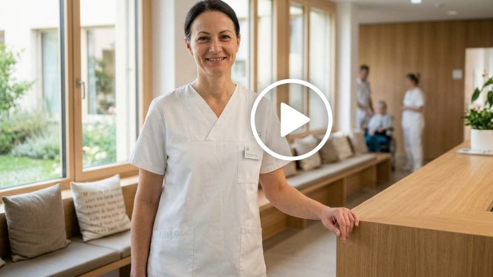

::: review-kopf
**Review-Fassung** der Seite «Ihr Eintritt, Schritt für Schritt», Stand 28. Oktober 2026. Diese Fassung bleibt bis zum Ende der Review-Runde unverändert.

Die Nummern am linken Rand bezeichnen jede Überschrift, jeden Absatz, jeden Listenpunkt und jede Tabellenzeile. Sie bleiben fest, unabhängig von Fenstergrösse und Zoom. Eine Nummer kann deshalb mehrere Bildschirmzeilen umfassen.

Bitte beginnen Sie jeden Kommentar mit der Nummer, zum Beispiel «Z. 42: …» oder «Z. 42 bis 45: …». Ein Klick auf eine Nummer erzeugt einen Direktlink auf die Stelle.

Rückmeldung bitte an [Name, E-Mail]{.ph} bis [Datum]{.ph}.
:::

::: review-technik
```{=html}
<script src="review-zeilennummern.js" defer></script>
```
:::

::: mini-nav
[⌂ Übersicht](index.qmd) [Alles auf einem Blatt →](merkblatt.qmd) [Ich begleite oder unterstütze jemanden →](begleiten.qmd)
:::

[Danke für Ihr Vertrauen in die Klinik St. Anna. Diese Seite führt Sie vom Tag der Anmeldung bis zur ersten Woche zu Hause. Jeder Abschnitt erklärt, was wir tun und was in Ihrer Hand liegt. Sie können diese Seite auch Ihren Angehörigen zeigen.]{.lede}

## So läuft Ihr Eintritt ab {#kurz}

::: kurzliste
1. [Nach der Anmeldung durch Ihren Arzt:](#heute) Gesundheitsfragebogen und Anmeldebestätigung
2. [Bis zum Eintritt:](#wochen) Narkosegespräch, Abholung und erste Woche zu Hause organisieren
3. [Am Vortag:](#vortag) Eintrittszeit per SMS, Essen und Trinken ausrechnen, packen
4. [Am Eintrittstag:](#eintrittstag) Ankommen, warten, Operation
5. [Im Spital:](#spital) Visite, Erholen, Austritt bis 10 Uhr
:::

```{=html}
<p class="werkzeuge">
<a class="werkzeug" href="merkblatt.qmd">Das Wichtigste auf einer Seite, auch zum Ausdrucken</a>
<a class="werkzeug" href="begleiten.qmd">Ich begleite oder unterstütze jemanden</a>
<span class="werkzeug ph">Italiano · Français: foglio informativo</span>
</p>
```

::: video-einstieg
[Wenn Sie mögen: Wir zeigen Ihnen im Video in zwei Minuten, wie Ihr Aufenthalt bei uns aussieht, von der Anmeldung bis zurück nach Hause. Sie müssen sich dabei nichts merken. Sie können auch einfach weiterlesen]{.einladung}



:::

::: weiche
**Kommen Sie zu einer Herzkatheter-Untersuchung?** Für Sie gilt ein eigener, kürzerer Fahrplan: [Herzkatheter: Ihr Fahrplan →](herzkatheter.qmd)

Für alle anderen Eingriffe geht es hier weiter.
:::

::: kontaktzeile
**So erreichen Sie uns.** Jede Frage ist willkommen. Rufen Sie lieber einmal mehr an.


:::

## Wo stehen Sie gerade? {#wo}

::: wo
- [Ich habe die E-Mail und SMS für den Gesundheitsfragebogen erhalten →](#heute)
- [Ich habe die Anmeldebestätigung per Post erhalten →](#wochen)
- [Mein Eintritt ist morgen →](#vortag)
- [Ich begleite oder unterstütze jemanden →](begleiten.qmd)
:::

::: {#kurz-weg .kurzweg}
**Ist Ihre Operation kurzfristig geplant?** Manchmal liegen zwischen Anmeldung und Operation nur wenige Tage. Die Reihenfolge unten bleibt dann gleich. Alles kommt nur etwas dichter. Sie haben nichts verpasst. Zuerst zählen: der Fragebogen, Ihre medizinischen Unterlagen, die Regeln für den Eintrittstag, und wer Sie nach dem Austritt nach Hause bringt.
:::

Alles Weitere steht unten. Was bei Ihnen schon erledigt ist, überspringen Sie einfach.

:::::::::::::::::::::::: zeit
:::::: station
## Nach der Anmeldung: Fragebogen und Bestätigung {#heute}

[Wann]{.wann} Ab dem Tag, an dem Ihre Ärztin oder Ihr Arzt Sie bei uns anmeldet.

### Was wir tun

Sie haben von uns eine **E-Mail** mit dem Link zum Gesundheitsfragebogen erhalten. Dazu kam eine SMS mit einem Sicherheitscode für den Fragebogen. Die **Anmeldebestätigung per Post** mit dem Eintrittsdatum und dem Eintrittsformular folgt, je nach Termin innerhalb von Tagen oder Wochen. Ab jetzt bereitet unser Team Ihren Aufenthalt für Sie vor.

::: echt
### So prüfen Sie, ob eine Nachricht von uns kommt

Wir fragen per SMS, Email oder Internet nie nach Passwörtern oder Bankdaten. Wir verlangen nie eine Zahlung. Wir setzen Sie nie unter Druck. Sind Sie unsicher, ob die Nachricht von uns ist? Suchen Sie selbst im Internet nach der Internetseite der Klinik St. Anna. Rufen Sie die Nummer an, die dort steht.
:::

### Was in Ihrer Hand liegt

::: tun
- Sie füllen den **Gesundheitsfragebogen** innerhalb von [5 Tagen]{.ph} aus, allein oder mit jemandem zusammen. Rechnen Sie mit 10 bis 60 Minuten. Mit Ihren Antworten geben Sie der Anästhesie Informationen, die sie für Ihre Narkoseplanung braucht. Falls Sie den Fragebogen schon ausgefüllt haben, ist dieser Punkt erledigt.
- Wenn Ihnen das Ausfüllen am Bildschirm schwerfällt, oder es technische Schwierigkeiten gibt: Dann lassen Sie den Fragebogen unausgefüllt. Nach etwa [5 Tagen]{.ph} rufen wir Sie von uns aus an.
- Sie füllen das **Eintrittsformular** aus dem Brief aus, unterschreiben es und senden es zurück, [Frist]{.ph}.
:::
::::::

::::: station
## Bis zum Eintritt: Vorbereitung und Narkosegespräch {#wochen}

[Wann]{.wann} Zwischen Anmeldung und Eintritt. Das können mehrere Wochen sein oder wenige Tage.

### Was wir tun

Ihre Narkose besprechen wir persönlich mit Ihnen, spätestens am Vortag am Telefon (siehe [Am Vortag](#vortag)). Je nach Eingriff und Gesundheit **laden wir Sie vorher zusätzlich in die Anästhesie-Sprechstunde ein**. Das Gespräch findet in der Klinik oder am Telefon statt. Um den Termin kümmern wir uns. Wir kontaktieren Sie. Im Gespräch mit der Anästhesistin oder dem Anästhesisten können Sie alles fragen, was Sie zur Narkose wissen möchten. [Gibt es für Ihren Eingriff mehrere Möglichkeiten der Narkose, entscheiden Sie mit.]{.ph} Brauchen Sie nach dem Aufenthalt eine Rehabilitation oder Spitex? Dann planen wir das jetzt gemeinsam mit Ihnen und rufen Sie an.

### Was in Ihrer Hand liegt

::: tun
- Sie organisieren, wer Sie zum Eintritt hinfährt und nach dem Austritt abholt. Nach einer Narkose dürfen Sie 24 Stunden nicht selbst fahren.
- Sie organisieren, wer Sie in der ersten Woche zu Hause unterstützt: Einkaufen, Kochen, Treppensteigen. [Haben Sie niemanden, der Sie abholt oder unterstützt? Sagen Sie es uns früh. Wir suchen mit Ihnen eine Lösung.]{.ph}
- Ihre Medikamente nehmen Sie weiter wie gewohnt. Blutverdünner und Diabetesmedikamente pausieren Sie nur nach Absprache mit der Anästhesie. Im Zweifel rufen Sie die Anästhesie an: [Anästhesie, Telefonnummer]{.ph}.
- Bei Fieber, Husten oder Erkältung rufen Sie die Anästhesie an: [Anästhesie, Telefonnummer]{.ph}. Das gilt auch kurz vor dem Eintritt und wenn es Ihnen insgesamt schlechter geht. Wir besprechen dann mit Ihnen die Planung.
:::

::: hilft
### Gönnen Sie sich eine bewusste Vorbereitung.

Je besser vorbereitet Sie in die Operation gehen, desto schneller erholen Sie sich danach. Vier Dinge sind wissenschaftlich gut belegt:

- Bewegen: Bleiben Sie in Bewegung, im Rahmen Ihrer Möglichkeiten. Das hilft Ihnen, nach der Operation schneller wieder zu Kräften zu kommen.
- Rauchstopp: Jeder rauchfreie Tag vor der Operation hilft. Je früher Sie aufhören, desto besser heilt die Wunde.
- Essen und Schlafen: Essen Sie regelmässig und eiweissreich und schlafen Sie genug. So gehen Sie mit Kraft in die Operation. Alkohol: je weniger, desto besser.
- Fragen: Schreiben Sie auf, was Sie wissen möchten, und nehmen Sie die Liste zu den Arztgesprächen mit.
:::

::: begleit
**Für Angehörige und Begleitpersonen:** Jetzt ist die Zeit, das Praktische zu klären: wer fährt, wer in der ersten Woche da ist, wer sich um Haustiere und Post kümmert. Schauen Sie auch die Wohnung an: Wege, Treppen, Stolperfallen, Teppiche, Dusche.
:::
:::::

::::: station
## Am Vortag: Uhrzeit und Vorbereitung {#vortag}

[Wann]{.wann} Am Tag vor dem Eintritt. Bei Eintritt am Montag: am Freitag davor.

### Was wir tun

**Ihre Eintrittszeit.** Sie erhalten sie am Vortag **per SMS**. Haben wir keine Handynummer von Ihnen, rufen wir Sie auf dem Festnetz an. Haben Sie am Vortag bis 14 Uhr nichts von uns gehört, rufen Sie uns an: [Patientendisposition, Nummer]{.ph}, 13 bis 17 Uhr.

**Der Anruf zur Narkose.** Am Vortag **ruft Sie Ihre Anästhesieärztin oder Ihr Anästhesiearzt an**, auch wenn Sie schon in der Sprechstunde waren. [Vor einem Eingriff am Montag kann dieser Anruf schon am Freitag oder am Sonntag kommen]{.ph}. Halten Sie dafür Ihre Medikamentenliste bereit. [Zeitfenster des Anrufs; was gilt, wenn Sie den Anruf verpassen: Rückrufnummer oder zweiter Versuch.]{.ph}

### Was in Ihrer Hand liegt

::: tun
- Sie schreiben die Eintrittszeit auf und rechnen zwei Uhrzeiten aus: bis wann Sie essen dürfen (6 Stunden vorher) und bis wann Sie trinken dürfen (2 Stunden vorher). Ein Rechenbeispiel steht gleich unten.
- Sie sind telefonisch erreichbar.
- Sie packen. Die Liste steht gleich unten. Legen Sie am Abend alles bereit, dann beginnt der Morgen ruhig.
:::

### Was Sie mitbringen





::: begleit
**Für Angehörige und Begleitpersonen:** Rechnen Sie die Zeiten für Essen und Trinken gemeinsam aus und schreiben Sie sie gut sichtbar auf, zum Beispiel an den Kühlschrank. Am Morgen des Eintritts ist das die wichtigste Hilfe.
:::
:::::

:::::: station
## Am Eintrittstag: Ankommen, warten, Operation {#eintrittstag}

[Wann]{.wann} Vom Aufstehen bis zum Abend.

### Was wir tun, und wie der Ablauf ist

**Morgens zu Hause.** Bis 6 Stunden vor der Eintrittszeit eine leichte Mahlzeit, bis 2 Stunden vorher Wasser, Tee oder schwarzer Kaffee. Danach nichts mehr, auch keine Bonbons oder Kaugummi. So schützen Sie Ihre Atemwege während der Narkose. Medikamente wie gewohnt mit einem Schluck Wasser, ausser die Anästhesie hat mit Ihnen etwas anderes vereinbart.

**Anreise.** [Adresse, Eingang, öffentlicher Verkehr. Während des Umbaus sind Parkplätze knapp. Kommen Sie am besten mit dem öffentlichen Verkehr oder lassen sich bringen.]{.ph}

**Ankommen.** Sie melden sich an der Réception und erhalten Ihr Patientenarmband mit Name, Geburtsdatum und einem Barcode. Im Lauf des Tages fragen wir Sie mehrmals nach Name und Geburtsdatum. So stellen wir sicher, dass jede Behandlung zur richtigen Person kommt. Sie können uns dabei helfen: Sagen Sie Ihren Namen ruhig jedes Mal von sich aus. An der Réception erfahren Sie, wo es weitergeht.

::: anders
### Zurzeit ist die Klinik St. Anna im Umbau

Während des **Umbaus der Klinik St. Anna** (ANNAplus, voraussichtlich bis [Datum]{.ph}) bereiten wir Sie in der Tagesklinik auf die Operation vor. Das gilt für alle Patientinnen und Patienten, unabhängig von der Versicherung. Die Plätze dort sind mit Vorhängen abgetrennt. Für vertrauliche Gespräche gibt es einen Besprechungsraum. Auch der Weg in den Operationsbereich ist während des Umbaus ein Provisorium. Ihr Zimmer beziehen Sie nach der Operation.
:::

**Warten.** Wir sind ein Akutspital und behandeln auch Notfälle. Deshalb stimmen wir den Operationsplan laufend ab. Zwischen Ihrer Ankunft und der Operation vergeht Zeit: manchmal eine halbe Stunde, manchmal mehrere Stunden. Wir halten Sie vor Ort auf dem Laufenden, wann Ihre Operation beginnt. Diese Zeit ist Ihre Zeit: lesen, Musik hören, mit Ihrer Begleitung reden, die Augen schliessen. Viele nutzen sie, um zur Ruhe zu kommen.

**Operation.** Eine Pflegefachperson begleitet Sie in den Operationsbereich. Dort empfängt Sie das Operationsteam und bleibt während der ganzen Operation bei Ihnen. Bekommen Sie eine Narkose, schlafen Sie dabei tief und ruhig. Das Anästhesieteam ist die ganze Zeit an Ihrer Seite und achtet auf Atmung und Kreislauf. Sie wachen im Aufwachraum auf oder, bei grösseren Eingriffen, auf der Überwachungsstation, wo wir Sie in der ersten Zeit enger betreuen. Wenn Sie aufwachen, ist jemand bei Ihnen. Dort können Sie in Ruhe wach werden. Was Sie brauchen, sagen Sie dem Team. Danach kommen Sie in Ihr Zimmer.

### Was in Ihrer Hand liegt

::: tun
- Sie sind zur vereinbarten Eintrittszeit an der Réception und halten den Ausweis bereit.
- Sie sagen, wenn etwas unklar ist, Sie etwas brauchen oder Ihnen etwas Sorgen macht. Fragen sind erwünscht, Nachfragen auch.
- Mit Essen und Trinken warten Sie, bis die Pflege das OK gibt.
:::

::: begleit
**Für Angehörige und Begleitpersonen:** Sie dürfen bis zur Tagesklinik mitkommen und dort [bis zur Abholung in den Operationsbereich]{.ph} bleiben. Hinterlassen Sie Ihre Telefonnummer. Wir rufen Sie an, sobald das Zimmer bezogen ist. Rechnen Sie mit [mehreren Stunden]{.ph}. Sie können in dieser Zeit die Klinik verlassen, wir erreichen Sie telefonisch.
:::
::::::

::::: station
## Die Tage im Spital {#spital}

[Wann]{.wann} Vom Abend der Operation bis zum Austritt, meist [2 bis 5]{.ph} Tage.

### Was wir tun

Ihre Ärztin oder Ihr Arzt kommt täglich zur Visite. Dort besprechen Sie gemeinsam, wie es Ihnen geht und wie es weitergeht, auch den Austrittstag. Ihre Fragen haben dort Platz. Die Pflege ist rund um die Uhr für Sie da. Sagen Sie uns, was Sie brauchen, um sich wohler zu fühlen. Je früher Sie es sagen, desto besser können wir helfen. Besuch: [Besuchszeiten]{.ph}.

::: hilft
### Was Ihnen jetzt hilft

Die Erholung beginnt gleich nach der Operation, und das meiste davon leisten Sie selbst. Vier Dinge helfen dabei besonders:

- Tief durchatmen, mehrmals am Tag. So bleibt die Atmung frei.
- Früh aufstehen und gehen, sobald die Pflege es freigibt. Die ersten Schritte sind die wichtigsten: Sie bringen Kreislauf, Atmung und Verdauung in Schwung, und die Kraft kehrt schneller zurück.
- Essen und trinken, sobald es erlaubt ist. Das gibt Ihnen die Energie für die nächsten Schritte.
- Nachts schlafen. Sagen Sie uns, wenn etwas Sie am Schlafen hindert.

Schmerzmittel sind dazu da, dass Sie sich bewegen, durchatmen und schlafen können. Nehmen Sie sie [nach dem Plan, den die Pflege mit Ihnen bespricht]{.ph}, und bevor der Schmerz stark wird. So bleibt er klein. Jeder Tag bringt Sie ein Stück weiter in Richtung Zuhause.
:::

### Was in Ihrer Hand liegt

::: tun
- Sie melden jede Beschwerde, auch kleine. Dann können wir früh etwas tun.
- Sie schreiben Fragen auf, wenn sie Ihnen einfallen, und stellen sie bei der Visite.
:::

::: begleit
**Für Angehörige und Begleitpersonen:** Sie dürfen bei der Visite dabei sein. Ob Sie dabei sind, entscheidet die Patientin oder der Patient. Ihre Besuche helfen: Vertraute Gesichter und Gespräche gehören zur Erholung. Fragen Sie nach dem voraussichtlichen Austrittstag und was zu Hause gebraucht wird: Hilfsmittel, Spitex, Rezepte.
:::
:::::

:::::: station
## Austritt und die erste Woche zu Hause {#austritt}

[Wann]{.wann} Am Austrittstag bis 10 Uhr, dann die ersten sieben Tage.

### Was wir tun

Sie erhalten einen Austrittsbericht, Rezepte und die Termine für Nachkontrollen. Die Pflege erklärt Ihnen Wundversorgung und Medikamente und gibt Ihnen alles schriftlich mit. Zu Hause erholen Sie sich weiter, in Ihrem eigenen Tempo.

Wir wünschen Ihnen einen guten Aufenthalt bei uns und eine gute Erholung zu Hause.

::: hilft
### Was Ihnen in der ersten Woche hilft

Was im Spital geholfen hat, hilft zu Hause weiter: jeden Tag etwas mehr gehen, regelmässig essen und trinken, Schmerzmittel nach dem Plan, den Sie mitbekommen haben, nachts schlafen. Die Kraft kommt Woche für Woche zurück. [Hinweise je nach Eingriff: Belastung, Duschen, Wunde.]{.ph}
:::

### Was in Ihrer Hand liegt

::: tun
- Sie geben das Zimmer bis 10 Uhr frei und lassen sich abholen.
- Sie lösen die Rezepte in der Klinikapotheke oder einer Apotheke Ihrer Wahl ein.
- Bei den Zeichen unten rufen Sie sofort an, auch nachts.
:::

::: care
### Sofort melden

Leichte Schmerzen, etwas Schwellung und Müdigkeit sind in den ersten Tagen normal und nehmen von Tag zu Tag ab. Sofort anrufen bei Fieber über 38.5 Grad, zunehmenden Schmerzen trotz Medikamenten, Rötung oder Nässen der Wunde, Atemnot, Brustschmerz oder Wadenschmerz: [Klinik-Nummer, rund um die Uhr]{.ph}. Bei Atemnot oder Brustschmerz direkt **144**.
:::

::: begleit
**Für Angehörige und Begleitpersonen:** In der ersten Nacht zu Hause sollte jemand erreichbar sein. Die Zeichen oben gelten auch für Sie: Wenn Ihnen etwas Sorgen macht, rufen Sie an.
:::
::::::
::::::::::::::::::::::::



::: mini-nav
[⌂ Übersicht](index.qmd) [Alles auf einem Blatt →](merkblatt.qmd) [Ich begleite jemanden →](begleiten.qmd)
:::

::: {#kontaktzone}

:::


