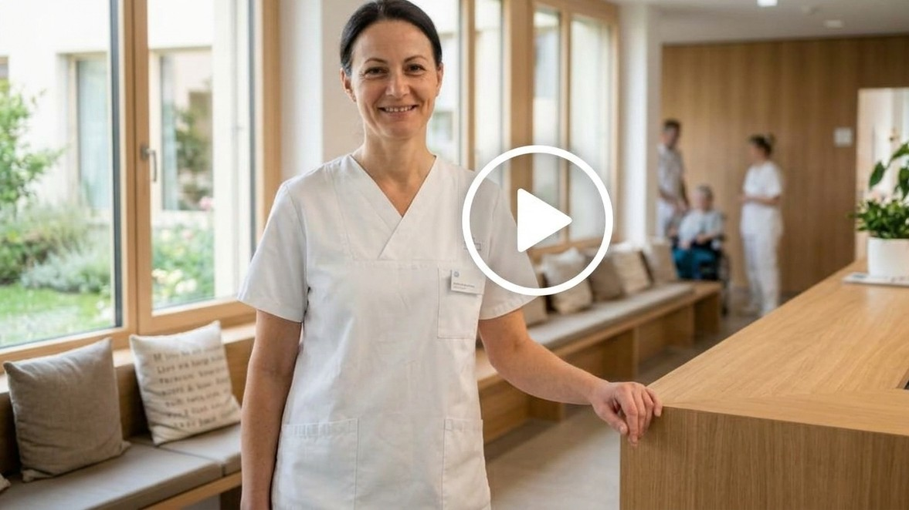

::: mini-nav
[⌂ Übersicht](index.qmd) [Alles auf einem Blatt →](merkblatt.qmd)
:::

[Danke für Ihr Vertrauen in die Klinik St. Anna. Diese Seite führt Sie vom Tag der Anmeldung bis zur ersten Woche zu Hause. Jeder Abschnitt erklärt, was wir tun und was in Ihrer Hand liegt.]{.lede}

::: weiche
**Kommen Sie zu einer Herzkatheter-Untersuchung?** Für Sie gilt teilweise anderes, vor allem bei Essen, Trinken und Medikamenten. Lesen Sie bitte zuerst hier: [Herzkatheter: Ihr Fahrplan →](herzkatheter.qmd)
:::

## So läuft Ihr Eintritt ab {#kurz}

Tippen Sie auf den Schritt, bei dem Sie gerade stehen. Was bei Ihnen schon erledigt ist, überspringen Sie.

::: kurzliste
1. [Nach der Anmeldung:](#heute) E-Mail und SMS zum Gesundheitsfragebogen
2. [Bis zum Eintritt:](#wochen) Anmeldebestätigung per Post, Narkosegespräch, Abholung und erste Woche zu Hause organisieren
3. [Am Vortag:](#vortag) Eintrittszeit per SMS, Zeiten für Essen und Trinken, packen
4. [Am Eintrittstag:](#eintrittstag) Ankommen, warten, Operation
5. [Im Spital und danach:](#spital) Visite, Erholung, Austritt bis 10 Uhr
:::

```{=html}
<p class="werkzeuge">
<a class="werkzeug" href="merkblatt.qmd">Das Wichtigste auf einer Seite, auch zum Ausdrucken</a>
<span class="werkzeug ph">Italiano · Français: foglio informativo</span>
</p>
```

::: {#film .video-einstieg}
[Ein kurzer Film zeigt Ihnen in gut einer Minute, wie die Bereiche aussehen, in denen Sie ankommen und warten.]{.einladung}



:::

::: kontaktzeile
**So erreichen Sie uns.** Jede Frage ist willkommen.


:::

::: {#kurz-weg .kurzweg}
**Ist Ihre Operation kurzfristig geplant?** Manchmal liegen zwischen Anmeldung und Operation nur wenige Tage. Die Reihenfolge bleibt dann gleich, die Schritte folgen nur dichter aufeinander. Sie haben nichts verpasst.
:::

:::::::::::::::::::::::: zeit
:::::: station
## Nach der Anmeldung: Fragebogen und Bestätigung {#heute}

[Wann]{.wann} Ab dem Tag, an dem Ihre Ärztin oder Ihr Arzt Sie bei uns anmeldet.

### Was wir tun

Sie haben von uns eine **E-Mail** mit dem Link zum Online-Gesundheitsfragebogen erhalten. Dazu kam eine SMS mit einem Sicherheitscode für den Fragebogen. Die **Anmeldebestätigung** mit dem Eintrittsdatum und den Eintrittsformularen kommt per Post. Je nach Termin kommt das Couvert von uns in einigen Tagen oder Wochen.


### Was in Ihrer Hand liegt

::: tun
- Sie füllen den **Gesundheitsfragebogen** innerhalb von [5 Tagen]{.ph} aus, allein oder mit jemandem zusammen. Rechnen Sie mit 10 bis 60 Minuten. Die Anästhesie ist das Team für Ihre Narkose. Sie braucht Ihre Antworten, um die Narkose zu planen. Falls Sie den Fragebogen schon ausgefüllt haben, ist dieser Punkt erledigt.
- Fällt Ihnen das Ausfüllen am Bildschirm schwer, oder funktioniert etwas technisch nicht? Dann lassen Sie den Fragebogen leer. Wir rufen Sie nach etwa [5 Tagen]{.ph} an.
- Sie füllen die Formulare im Couvert aus, das wir Ihnen zusenden, unterschreiben sie und senden sie möglichst bald{.ph} zurück.
- Sind Sie über 70 Jahre alt, oder haben Sie eine Krankheit an Herz oder Kreislauf oder eine andere gesundheitliche Einschränkung? Dann gehen Sie bitte jetzt zu Ihrer **Hausärztin oder Ihrem Hausarzt** und lassen dort einen Gesundheitsbericht ausstellen. Den Bericht schicken Sie an zuweiserberichte@hirslanden.ch.
:::
::::::

::::: station
## Bis zum Eintritt: Vorbereitung und Narkosegespräch {#wochen}

[Wann]{.wann} Zwischen Anmeldung und Eintritt. Das können mehrere Wochen sein oder wenige Tage.

### Was wir tun

Wir besprechen Ihre Narkose mit Ihnen, spätestens am Vortag am Telefon (siehe [Am Vortag](#vortag)). Je nach Operation und Gesundheitszustand **laden wir Sie vorher zusätzlich zu einem Narkosegespräch in die Anästhesie-Sprechstunde ein**. Dieses Gespräch findet in der Klinik oder am Telefon statt. Für den Termin melden wir uns bei Ihnen. Im Gespräch mit der Anästhesieärztin oder dem Anästhesiearzt wird Ihre Narkose auf Sie abgestimmt. Sie können auch alles fragen, was Sie zur Narkose wissen möchten.

Brauchen Sie nach dem Aufenthalt eine Rehabilitation oder die Spitex (Pflege zu Hause)? Dann rufen wir Sie an und planen das mit Ihnen. Fragen dazu: Case Management (Telefon)

### Was in Ihrer Hand liegt

::: tun
- Sie organisieren, wer Sie zum Eintritt hinfährt und nach dem Austritt abholt. Nach einer Narkose dürfen Sie 24 Stunden nicht selbst fahren.
- Je nach Operation brauchen Sie eventuell in der ersten Woche zu Hause Hilfe, zum Beispiel beim Einkaufen oder auf der Treppe. Klären Sie früh, wer das übernimmt. Haben Sie niemanden, der Sie abholt oder unterstützt? Sagen Sie es uns früh. Wir suchen mit Ihnen eine Lösung (Case Management Tel.).
- Gehen Sie nach der Operation an Stöcken, oder sind Sie dann unsicher auf den Beinen? Dann räumen Sie vorher weg, worüber Sie stolpern könnten, zum Beispiel lose Teppiche.
- Nehmen Sie Blutverdünner oder Diabetesmedikamente? Dann sagt Ihnen die Anästhesie, ob Sie diese vor der Operation weglassen sollen und ab welchem Tag. Bis dahin nehmen Sie sie wie gewohnt.
- Alle anderen Medikamente nehmen Sie weiter wie gewohnt. Falls Änderungen nötig sind, werden sie von der Anästhesie oder Ihrer Operateurin oder Ihrem Operateur darauf hingewiesen.
- Bei Fieber, Husten oder Erkältung vor der Operation rufen Sie die Anästhesie an: +41 41 208 33 88. Das gilt auch kurz vor dem Eintritt und wenn es Ihnen insgesamt schlechter geht. Diese Information ist sehr wichtig für uns.
:::

::: hilft
### Was Sie vor der Operation für sich tun können

Vier Dinge helfen Ihnen zur Vorbereitung auf die Operation:

- Bewegen: Spazieren oder gehen Sie jeden Tag, so gut es Ihnen möglich ist. Dann kommen Sie nach der Operation schneller wieder zu Kräften.
- Nicht rauchen: Jeder rauchfreie Tag vor der Operation hilft der Wunde beim Heilen.
- Essen und schlafen: Essen Sie regelmässig und genug Eiweiss, zum Beispiel Milchprodukte, Eier, Fisch, Fleisch oder Hülsenfrüchte. Schlafen Sie genug, und trinken Sie wenig oder keinen Alkohol.
- Fragen aufschreiben: Notieren Sie, was Sie wissen möchten, und nehmen Sie die Liste zu den Arztgesprächen mit.
:::

:::::

::::: station
## Am Vortag: Uhrzeit und Vorbereitung {#vortag}

[Wann]{.wann} Am Tag vor dem Eintritt. Treten Sie an einem Montag ein, ist es der Freitag davor.

### Was wir tun

**Ihre Eintrittszeit.** Am Vortag erhalten Sie **per SMS** die Uhrzeit, zu der Sie in der Klinik sein sollen. Haben Sie keine Handynummer, oder ist bis 14 Uhr keine SMS gekommen? Dann rufen Sie uns am selben Nachmittag an, bis 17 Uhr: Patientendisposition, +41 41 208 30 12.

**Der Anruf zur Narkose.** Am Vortag **ruft Sie Ihre Anästhesieärztin oder Ihr Anästhesiearzt an**, auch wenn Sie schon in der ANästhesiesprechstunde waren. [Vor einem Eintritt am Montag kann dieser Anruf schon am Freitag oder am Sonntag kommen]{.ph}. Halten Sie dafür Ihre Medikamentenliste bereit. [Zeitfenster des Anrufs; was gilt, wenn Sie den Anruf verpassen: Rückrufnummer oder zweiter Versuch.]{.ph}

### Was in Ihrer Hand liegt

::: tun
- Sie schreiben die Eintrittszeit aus der SMS auf und dazu zwei Uhrzeiten: bis wann Sie essen dürfen (6 Stunden vorher) und bis wann Sie trinken dürfen (2 Stunden vorher). In der Liste «Bis wann essen, bis wann trinken?» sind Beispielzeiten ausgerechnet.
- Sie sind am Nachmittag telefonisch erreichbar, für den Anruf der Anästhesie.
- Sie packen. Was Sie mitbringen, steht in der Liste unten. Legen Sie am Abend alles bereit.
:::

### Was Sie mitbringen





:::::

:::::: station
## Am Eintrittstag: Ankommen, warten, Operation {#eintrittstag}

[Wann]{.wann} Vom Aufstehen bis zum Abend.

### Was wir tun und wie der Tag abläuft

**Morgens zu Hause.** Bis 6 Stunden vor der Eintrittszeit dürfen Sie eine leichte Mahlzeit essen[, zum Beispiel Brot mit Konfitüre (Beispiel von der Anästhesie zu bestätigen)]{.ph}. Bis 2 Stunden vorher dürfen Sie Wasser, Tee oder Kaffee ohne Milch trinken. Danach nehmen Sie nichts mehr zu sich, auch keine Bonbons und keinen Kaugummi. So schützen Sie Ihre Atemwege während der Narkose. Ihre Medikamente nehmen Sie mit einem Schluck Wasser, so wie Sie es mit der Anästhesie besprochen haben.

**Anreise.** [Adresse, Eingang, öffentlicher Verkehr. In Luzern sind während des Umbaus Parkplätze knapp. Kommen Sie am besten mit dem öffentlichen Verkehr oder lassen Sie sich bringen.]{.ph}

**Ankommen.** Sie melden sich an der Réception und erhalten Ihr Patientenarmband mit Name, Geburtsdatum und einem Barcode. Im Lauf des Tages fragen wir Sie mehrmals nach Name und Geburtsdatum. So stellen wir sicher, dass jede Behandlung zur richtigen Person kommt. Von der Réception begleiten wir Sie in den Vorbereitungsbereich.

**Ihr Platz.** Im Vorbereitungsbereich bereiten wir alle Patientinnen und Patienten auf die Operation vor. Sie haben dort einen eigenen Platz, der mit einem Vorhang abgetrennt ist. Hier ziehen Sie sich um und warten. Ihr Spitalzimmer beziehen Sie nach der Operation. In der Klinik St. Anna bauen wir zurzeit neu, voraussichtlich bis [Datum]{.ph}. Der Vorbereitungsbereich und der Weg in den Operationsbereich sind dort deshalb eine Übergangslösung. [Wie der Vorbereitungsbereich aussieht, zeigt der kurze Film oben auf dieser Seite.](#film)

**Warten.** Bis Ihre Operation beginnt, kann es eine halbe Stunde dauern oder mehrere Stunden. Wie lange die Operationen vor Ihnen dauern, lässt sich nicht genau planen, denn wir nehmen uns für jede Patientin und für jeden Patienten die Zeit, die es braucht. Die Pflege kommt bei Ihnen vorbei und hält Sie auf dem Laufenden. Nehmen Sie etwas zum Lesen, Hören oder Arbeiten mit.

**Ihre Begleitperson.** Sie darf mitkommen und am Platz mit Ihnen warten, sie muss aber nicht bleiben. Nur wenn sehr viel Betrieb ist, bittet die Pflege sie, draussen zu warten. Möchte Ihre Begleitperson nicht in der Klinik warten, gibt sie an der Réception ihre Telefonnummer an. Wir rufen sie auf Wunsch unter dieser Nummer an, sobald Sie in Ihrem Zimmer sind. Bis zu diesem Anruf vergehen [mehrere Stunden]{.ph}.

**Operation.** Wenn es so weit ist, bringt Sie eine Pflegefachperson in den Operationsbereich. Dort empfängt Sie das Operationsteam und bleibt während der ganzen Operation bei Ihnen. Bei einer Vollnarkose schlafen Sie während der ganzen Operation tief. Bei einer Teilnarkose spüren Sie im betäubten Bereich nichts und können wach bleiben oder leicht schlafen, so wie Sie es mit der Anästhesie besprochen haben. Das Anästhesieteam achtet die ganze Zeit auf Ihre Atmung, Ihren Kreislauf und Ihr Wohlergehen. Sie wachen im Aufwachraum auf. Nach grösseren Operationen wachen Sie auf der Überwachungsstation auf. Dort betreuen wir Sie in der ersten Zeit enger. Wenn Sie aufwachen, ist jemand bei Ihnen. Danach kommen Sie in Ihr Zimmer.

### Was in Ihrer Hand liegt

::: tun
- Sie sind zur Eintrittszeit aus der SMS an der Réception und halten den Ausweis bereit.
- Sie sagen, wenn etwas unklar ist, wenn Sie etwas brauchen oder wenn Ihnen etwas Sorgen macht. Sie dürfen auch ein zweites Mal nachfragen.
- Nach der Operation warten Sie mit Essen und Trinken, bis die Pflege es Ihnen erlaubt.
:::

::::::

::::: station
## Die Tage im Spital {#spital}

[Wann]{.wann} Vom Abend der Operation bis zum Austritt, meist [2 bis 5]{.ph} Tage.

### Was wir tun

Ihre Ärztin oder Ihr Arzt besucht Sie jeden Tag im Zimmer (Visite). Sie besprechen dabei, wie es Ihnen geht, wie es weitergeht und wann Sie austreten. Stellen Sie dort auch Ihre Fragen. Wenn Sie es möchten, dürfen Ihre Angehörigen bei der Visite dabei sein. Die Pflege ist Tag und Nacht erreichbar. Sagen Sie früh, was Sie brauchen. Dann können wir gut helfen. Besuch können Sie [Besuchszeiten]{.ph} empfangen.

::: hilft
### Was Ihnen jetzt hilft

Die Erholung beginnt gleich nach der Operation. Sie können selbst viel dazu beitragen:

- Tief durchatmen, mehrmals am Tag. So bleibt die Atmung frei.
- Aufstehen und gehen, sobald die Pflege es erlaubt. Das regt Kreislauf, Atmung und Verdauung an, und Sie kommen schneller wieder zu Kräften.
- Essen und trinken, sobald es erlaubt ist. Das gibt Ihnen Kraft.
- Nachts schlafen. Sagen Sie uns, wenn etwas Sie am Schlafen hindert.

Schmerzmittel sind dazu da, dass Sie sich bewegen, durchatmen und schlafen können. Nehmen Sie die Schmerzmittel [nach dem Plan, den die Pflege mit Ihnen bespricht]{.ph}, und bevor der Schmerz stark wird. So bleibt er erträglich und IHr Körper kann sich besser erholen.
:::

### Was in Ihrer Hand liegt

::: tun
- Sie sagen der Pflege, wenn Ihnen etwas wehtut oder sich ungewohnt anfühlt, auch wenn es klein scheint. Dann können wir früh etwas tun.
- Sie schreiben Fragen auf, wenn sie Ihnen einfallen, und stellen sie bei der Visite.
:::

:::::

:::::: station
## Austritt und die erste Woche zu Hause {#austritt}

[Wann]{.wann} Am Austrittstag verlassen Sie das Zimmer bis 10 Uhr. Danach folgen die ersten sieben Tage zu Hause.

### Was wir tun

Sie erhalten einen Austrittsbericht, Rezepte und die Termine für Nachkontrollen. Die Pflege und der Arzt erklären Ihnen, wie Sie die Wunde pflegen und die Medikamente einnehmen, und gibt Ihnen alles schriftlich mit.

::: hilft
### Was Ihnen in der ersten Woche hilft

Was im Spital geholfen hat, hilft auch zu Hause. Gehen Sie jeden Tag etwas mehr, essen und trinken Sie regelmässig, nehmen Sie die Schmerzmittel nach dem Plan, den Sie mitbekommen haben, und schlafen Sie nachts. Bis Sie wieder bei Kräften sind, braucht es Zeit. Wann Sie wieder arbeiten, Auto fahren, heben und Sport treiben dürfen, hängt von der Operation ab. Das sagt Ihnen Ihre Ärztin oder Ihr Arzt. Müssen Sie vorher planen, fragen Sie schon vor dem Eintritt in der Praxis nach. [Hinweise je nach Operation: Belastung, Duschen, Wunde.]{.ph}
:::

### Was in Ihrer Hand liegt

::: tun
- Sie geben das Zimmer bis 10 Uhr frei und lassen sich abholen.
- Sie sorgen dafür, dass in der ersten Nacht zu Hause jemand für Sie erreichbar ist.
- Sie lösen die Rezepte in der Klinikapotheke oder einer Apotheke Ihrer Wahl ein.
- Bei den Anzeichen, die unten unter «Sofort melden» stehen, rufen Sie sofort an, auch nachts.
:::

::: care
### Sofort melden

Leichte Schmerzen, etwas Schwellung und Müdigkeit sind in den ersten Tagen normal und nehmen von Tag zu Tag ab. Rufen Sie uns sofort an, wenn Sie Fieber über 38.5 Grad haben, wenn die Schmerzen trotz Medikamenten zunehmen, wenn die Wunde rot wird oder nässt oder wenn eine Wade schmerzt. Die Nummer ist [Klinik-Nummer, rund um die Uhr]{.ph}. Bei Atemnot oder Schmerzen in der Brust wählen Sie direkt den Notruf **144**.
:::


Wir wünschen Ihnen einen guten Aufenthalt bei uns und eine gute Erholung zu Hause.
::::::
::::::::::::::::::::::::



::: mini-nav
[⌂ Übersicht](index.qmd) [Alles auf einem Blatt →](merkblatt.qmd)
:::

::: {#kontaktzone}

:::


